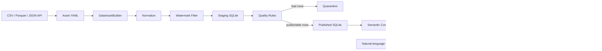

# QueryForge 数据开发实习面试手册

> 适用岗位：数据开发实习生、数据工程实习生、离线数仓开发实习生、AI 数据应用实习生  
> 项目名称建议：**QueryForge——可治理的数据工程与 NL2SQL 分析平台**  
> 阅读目标：能讲清项目价值、数据链路、关键实现、技术取舍、能力边界，并能完成现场演示与代码追问。

---

## 0. 使用这份手册的方法

这不是一篇需要逐字背诵的项目说明书。面试前按以下顺序学习：

1. 先掌握第 1～4 章，能够用 1 分钟讲清项目。
2. 再掌握第 5～10 章，能够解释数据管道、Watermark、质量和语义层。
3. 然后掌握第 11～14 章，能够回答 NL2SQL、安全、存储和 API 问题。
4. 最后练习第 18～22 章的高频追问、演示脚本和模拟面试。

面试中遵守三个原则：

- 先讲业务问题，再讲技术实现。
- 先讲当前实现，再讲生产扩展。
- 不把“设计上可以扩展”说成“已经实现”。

---

## 1. 项目到底是做什么的

### 1.1 最容易理解的版本

QueryForge 把两类工作连接起来：

1. 把 CSV、Parquet 或分页 JSON API 中的原始数据，经过增量过滤、质量校验和坏数据隔离，发布为可查询的 SQLite 数据资产。
2. 让用户用自然语言提问，系统结合数据库结构、业务语义和 SQL 安全策略生成只读 SQL，执行后返回表格、解释、图表和运行证据。

因此它不是单纯的“聊天生成 SQL”，也不是传统 ETL 脚本，而是一个小型、可审计的：

```text
数据接入 → 数据治理 → 数据发布 → 语义建模 → 自然语言查询
```

闭环。

### 1.2 为什么要做这个项目

普通 NL2SQL 常见三个问题：

- 数据可能还没有经过质量治理，查询结果不可信。
- 大模型只看到物理表名和字段名，不知道业务口径。
- 生成的 SQL 可能越权、访问敏感字段或执行危险操作。

QueryForge 的思路是：在生成 SQL 前先治理数据和语义，在执行 SQL 前再做确定性的安全检查。

### 1.3 一句话介绍

> QueryForge 是一个面向分析场景的可治理数据工程与 NL2SQL 平台，通过声明式 YAML 驱动 CSV、Parquet 和 API 数据接入，完成增量处理、数据质量校验、Quarantine、SQLite 原子发布和语义建模，并在查询侧通过语义层与 SQL AST 策略约束大模型生成的只读 SQL。

### 1.4 30 秒介绍

> 我做的 QueryForge 主要包含数据资产管道和自然语言分析两条链路。数据管道通过 YAML 定义数据源、字段映射、Watermark、唯一键和质量阈值，把原始数据经过 Staging、质量校验和坏数据隔离后发布到 SQLite，同时记录 Watermark、运行行数和血缘。查询侧基于经过人工评审的语义模型识别实体、粒度和指标，再由大模型生成 SQL，执行前通过 SQLGlot 解析 AST，限制表、字段、函数、Join 和返回行数。项目重点不是单纯生成 SQL，而是让数据进入和 SQL 执行都有治理边界和审计证据。

### 1.5 90 秒介绍

> 这个项目解决的是“原始数据如何安全进入分析系统，以及用户如何可靠地用自然语言查询”两个连续问题。第一条链路是数据工程链路，配置文件声明数据来源、目标表、字段别名、Watermark、必填字段、唯一键、失败阈值和业务语义。程序读取数据后先做字段和值标准化，再按上次成功 Watermark 筛选增量，写入 Staging，检查空值和重复键，把异常行写入 Quarantine。如果坏数据比例超过阈值，整个批次失败；如果通过，就发布到 SQLite，并且只根据实际可发布的数据推进 Watermark。数据和语义作为一个批次发布，失败时恢复发布检查点。
>
> 第二条链路是 NL2SQL。用户的问题会经过日期解析、Schema Linking、技能和指标匹配、SQL 生成、执行、结果反思以及有限次数修复。SQL 在执行前由 AST 策略引擎校验，只允许单条只读查询，还能配置表字段白名单、最大 Join 数和最大返回行数。最终结果带有 run_id、SQL、执行结果和可选报告，方便审计。当前版本是面向本地和中小规模数据的工程原型，SQLite、单进程锁和内存读取都有明确边界；生产化可以迁移到湖仓或分布式计算引擎。

---

## 2. 为什么它适合数据开发实习岗位

项目能够覆盖数据开发面试常见知识点：

| 数据开发能力 | 项目中的对应实现 |
|---|---|
| 数据接入 | CSV、Parquet、分页 JSON API |
| 数据清洗 | 字段规范化、空字符串转空值、数值类型转换 |
| 增量处理 | 持久化 Watermark |
| Staging | 独立 `staging.sqlite` |
| 数据质量 | 必填、唯一键、空值率、范围、外键等规则 |
| 坏数据治理 | Quarantine 表保存原始记录和失败原因 |
| 幂等重跑 | Watermark + 目标表已有唯一键检查 |
| 数据发布 | append/replace、Schema Drift 检查、失败恢复 |
| 元数据 | Watermark、Lineage、Quarantine、语义目录、运行证据 |
| 数据建模 | Entity、Grain、Dimension、Metric、Relationship、Join Path |
| 数据安全 | SQL AST、只读连接、表列白名单、复杂度限制 |
| 可观测性 | run_id、行数、状态、错误、运行历史 |
| 服务化 | FastAPI + 前端代理接口 |

面试时不要把重点放在“页面好看”或者“支持中英文”。对数据开发岗位，更有价值的是：

- 为什么需要 Staging。
- Watermark 为什么只从合格数据计算。
- 如何判断批内重复和目标表重复。
- 质量失败后如何保证数据与状态一致。
- 为什么需要 Grain 和 Join Path。
- SQL 如何做到确定性安全控制。

---

## 3. 当前实现、演示能力与生产能力边界

这是最重要的一章。面试官通常会通过边界问题判断你是否真正理解项目。

### 3.1 当前真实实现

- Python 数据资产管道支持 CSV、Parquet 和分页 JSON API。
- YAML 配置使用 Pydantic 做严格校验，未知字段会被拒绝。
- 支持字段标准化、字段别名和基础类型转换。
- 支持单字段 Watermark 增量筛选。
- 支持必填字段、组合唯一键和坏数据比例阈值。
- 支持把坏数据和原因写入 Quarantine。
- 支持 append 和 replace 发布模式。
- 支持目标表 Schema Drift 阻断。
- 支持数据与语义批次失败后的发布检查点恢复。
- 支持语义模型构建、校验和人工 reviewed 门禁。
- 支持自然语言生成 SQL、执行、反思和有限重试。
- 支持 SQL AST 安全策略和 SQLite `query_only` 只读连接。
- 支持 FastAPI 健康检查、管道状态、管道运行和问答接口。
- 支持 Web 工作台展示数据域、数据源、管道、语义、问答和运行历史。

### 3.2 演示专用能力

`PipelineRuntime` 默认绑定示例资产 `anime_watch_events`，并提供两个场景：

- `standard`：正常管道或幂等空运行。
- `quality_failure`：自动复制示例 CSV，并追加一条缺失 `anime_title` 的新数据，用于稳定展示质量失败。

这意味着网页上的“运行管道”按钮目前主要用于演示固定样例，并不是完整的通用调度平台。

### 3.3 当前还没有完全实现

- 网页已打通单个 CSV/Parquet 的真实剖析、`DataAssetBuilder` 发布和新数据域查询，但还不是支持任意连接器的通用调度平台。
- 网页上传目前按一个文件对应一个受治理资产处理，多文件依赖关系和跨资产 Join Path 仍需后续完善。
- 没有 MySQL、PostgreSQL、Kafka、Flink 或 CDC 日志连接器。
- 没有分布式调度、跨进程锁、任务队列和 Worker 集群。
- 没有增量 Upsert、复合游标和迟到数据回看窗口。
- 没有 SCD Type 2、分区表、Compaction 和小文件治理。
- SQLite 不是亿级数据生产仓库。
- 不能声称端到端 exactly-once。

### 3.4 面试中的正确说法

> 当前版本定位为本地可运行的工程原型，重点验证数据治理和 NL2SQL 的闭环。它实现了可重跑幂等、质量门禁、语义门禁和只读 SQL 安全，但没有把 SQLite 和单进程执行包装成分布式生产系统。对于更大规模场景，我会把控制面和执行面分离，计算迁移到 Spark/Flink，存储迁移到湖仓或数仓，并增加任务队列、分布式锁、复合游标和 Upsert。

---

## 4. 总体架构



### 4.1 分层与代码位置

| 层 | 职责 | 主要位置 |
|---|---|---|
| 数据源适配 | 读取 CSV、Parquet、API | `queryforge/data_assets/sources.py` |
| 数据转换 | 标准化、质量、Watermark 比较 | `queryforge/data_assets/transforms.py` |
| 数据资产编排 | Staging、发布、回滚、元数据 | `queryforge/data_assets/pipeline.py` |
| 语义域模型 | Entity、Metric、Relationship | `queryforge/domain/semantic/` |
| SQL 治理 | AST 解析与策略判断 | `queryforge/domain/security/sql_policy.py` |
| 数据库工具 | 受策略保护的 Schema 和 SQL 执行 | `queryforge/infrastructure/tools/database_tool.py` |
| 查询工作流 | 日期、Schema、SQL、反思、修复 | `queryforge/workflow/` |
| 应用服务 | 统一问答和管道运行入口 | `queryforge/application/` |
| API | FastAPI 路由 | `queryforge/interfaces/api/app.py` |
| Web | 工作台和后端代理 | `web/app/` |

### 4.2 两条主链路

数据链路：

```text
配置加载
→ 数据读取
→ 标准化
→ Watermark 增量过滤
→ Staging
→ 行级质量检查
→ Quarantine
→ 阈值判断
→ 目标表发布
→ Watermark 更新
→ 语义契约校验
→ 成功提交或整批恢复
```

查询链路：

```text
自然语言问题
→ 日期解析
→ Schema Linking
→ 技能与指标检索
→ SQL 候选生成
→ AST 策略检查
→ 只读执行
→ 结果反思
→ 有限修复
→ 表格、图表和报告
```

---

## 5. 人工需要提供什么，系统自动做什么

### 5.1 首次接入数据时

人工需要提供：

- 数据源文件或 API 地址。
- API 密钥对应的环境变量。
- 目标表名。
- 字段别名。
- Watermark 字段。
- 必填字段。
- 唯一键。
- 最大无效率。
- 实体名称、粒度、维度、指标和负责人。
- SQL 表字段访问策略。

系统自动生成或维护：

- `run_id`。
- `watermark_before` 和 `watermark_after`。
- Staging 表。
- `input_rows`、`staged_rows`、`published_rows`、`quarantined_rows`。
- Quarantine 失败原因。
- Lineage 和运行历史。
- 目标 SQLite 表。
- SQL、结果、图表和报告。

### 5.2 YAML 是否每批都要重新写

不需要。YAML 是数据资产的长期契约，不是每个 CSV 的附件。

第一次接入：

```text
anime_watch_events_2026_01.csv
assets.yml
```

第二批数据如果结构和规则不变：

```text
anime_watch_events_2026_02.csv
复用原来的 assets.yml，只改变路径或由调度参数传入新位置
```

只有以下情况才应修改配置：

- 字段结构变化。
- 唯一键变化。
- 增量字段变化。
- 质量标准变化。
- 业务粒度或指标口径变化。

### 5.3 示例配置

```yaml
version: 1

semantic_model:
  name: anime_watch_asset
  description: 动漫播放事件语义模型
  owner: engagement-analytics
  reviewed: true
  auto_count_metrics: true
  metrics:
    - name: uploaded_watch_hours
      description: 总观看小时数
      entity: watch_events
      aggregation: sum
      expression: SUM(fact_watch_events.watch_seconds) / 3600.0
      allowed_dimensions:
        - watch_events.anime_title
        - watch_events.device_type
      time_field: fact_watch_events.watched_at

assets:
  - name: anime_watch_events
    target_table: fact_watch_events
    publish_mode: append

    source:
      type: csv
      path: anime_watch_events.csv

    column_aliases:
      Event ID: event_id
      Anime Title: anime_title
      Watched At: watched_at
      Watch Seconds: watch_seconds

    watermark_field: watched_at

    quality:
      required_columns:
        - event_id
        - anime_title
        - watched_at
        - watch_seconds
      unique_key:
        - event_id
      max_invalid_ratio: 0.05

    semantic:
      entity_name: watch_events
      entity_type: fact
      description: 一行代表一次播放事件
      grain:
        - event_id
      dimensions:
        - event_id
        - anime_title
        - watched_at
        - device_type
      owner: engagement-analytics
      sensitivity: internal
      quality_rules:
        - rule: range
          column: watch_seconds
          minimum: 0
```

### 5.4 为什么配置必须由人确认

程序可以推断字段类型和候选主键，但无法可靠决定：

- 一行究竟代表订单、订单明细还是用户。
- GMV 是否包含退款、税费和运费。
- 用户数是 `COUNT(*)` 还是 `COUNT(DISTINCT user_id)`。
- 哪个字段允许被分析人员看到。
- 一对多关联是否会导致指标放大。

这些属于业务契约，必须经过人工审核。

---

## 6. 一次数据管道的完整执行过程

### 6.1 加载与校验配置

`build_from_file()` 读取 YAML，并通过 Pydantic 模型校验：

- 数据源类型是否合法。
- CSV/Parquet 是否配置路径。
- API 是否配置 URL。
- 发布模式是否合法。
- 资产名称和目标表是否重复。
- Watermark 与 replace 是否构成不支持的组合。

配置采用严格模式，写错字段不会被静默忽略。

### 6.2 人工审核门禁

批次发布前要求：

```yaml
semantic_model:
  reviewed: true
```

它表示负责人已经审核实体粒度、隐藏字段、关系、Join Path 和指标定义。未审核时整个发布被阻断。

### 6.3 创建发布检查点

在处理多资产批次前，系统备份发布数据库和元数据数据库。

目的：

- 如果某个资产失败，前面已经发布的资产不能单独保留。
- 如果数据发布成功但语义契约失败，数据与语义不能处于不同版本。

### 6.4 生成 run_id 并读取旧 Watermark

每次资产运行生成：

```text
asset_<随机UUID>
```

然后从元数据数据库的 `asset_watermarks` 表读取上一次成功位置。

### 6.5 读取数据源

当前支持：

- CSV：`csv.DictReader`，使用 `utf-8-sig` 兼容 BOM。
- Parquet：`pyarrow.parquet.read_table()`。
- API：GET JSON、`records_path`、页码分页、最大页数和 30 秒超时。

API 中的敏感信息通过 `${ENV_NAME}` 引用环境变量，而不直接写入 YAML。

### 6.6 字段和值标准化

字段标准化包括：

- Unicode 转 ASCII。
- 非字母数字替换为下划线。
- 转小写。
- 数字开头时增加 `field_`。
- 冲突字段增加序号。

值标准化包括：

- 去除字符串首尾空格。
- 空字符串转 `None`。
- 整数字符串转 `int`。
- 小数字符串转 `float`。
- 字典和列表转稳定 JSON 字符串。

### 6.7 Watermark 增量过滤

如果上次 Watermark 为 `2026-01-03`，只保留：

```text
watched_at > 2026-01-03
```

的记录。

Watermark 比较先尝试数值比较，不能转成数值时使用字符串比较。因此 ISO 形式日期 `YYYY-MM-DD` 可以按字典序正确比较，但任意日期格式不一定安全。

### 6.8 写入 Staging

增量记录被写入独立 `staging.sqlite` 的：

```text
staging_anime_watch_events
```

Staging 的意义：

- 原始数据不直接污染正式表。
- 可以在发布前完成验证。
- 失败批次更容易排查。
- 正式表只接收通过门禁的数据。

### 6.9 质量检查

第一层是行级接入质量：

- 必填字段是否为空。
- 唯一键是否为空。
- 唯一键是否在本批或目标表中重复。

第二层是语义契约质量：

- 物理表和字段是否存在。
- 主键/粒度是否非空且唯一。
- 空值率、唯一性、范围、外键等规则是否满足。
- 关系和 Join Path 是否能够在物理结构上成立。

不要把这两层混为一谈。第一层决定哪些行可发布，第二层决定发布后的数据和语义是否满足分析合同。

### 6.10 Quarantine

异常行不会直接丢弃，而是保存：

```text
run_id
asset_name
reason
raw_record_json
created_at
```

Quarantine 的作用：

- 让坏数据可追踪。
- 支持修复后重放。
- 统计失败原因。
- 避免为了少量坏数据完全丢失可用数据。

### 6.11 质量阈值

```text
invalid_ratio = quarantined_rows / staged_rows
```

假设阈值是 5%：

- 1000 行增量，20 行坏数据，2%：允许发布 980 行。
- 1000 行增量，80 行坏数据，8%：整个资产失败。
- 只有 1 行增量且该行失败：无效率 100%，整个资产失败。

### 6.12 发布目标表

`append`：

- 目标表不存在时根据当前数据推断 SQLite 类型并建表。
- 表存在时要求列顺序和列集合一致。
- 通过检查的记录追加写入。

`replace`：

- 删除旧表并使用本批数据重建。
- 适合全量快照，不适合和单调 Watermark 同时使用。

### 6.13 计算新 Watermark

新 Watermark 只从 `publishable` 记录中计算，而不是从原始输入或 Staging 中计算。

原因：如果最大时间的记录是坏数据却推进了 Watermark，修复后的这条数据再次到达时会因为时间不大于 Watermark 而永久丢失。

### 6.14 发布语义模型

数据资产完成后，先写一个 `.pending.yml` 语义文件，再执行契约校验：

- 通过：原子替换正式语义文件。
- 失败：删除 pending 文件，标记批次失败。

### 6.15 成功或失败恢复

如果所有资产和语义都成功，删除备份检查点。

如果任意资产或语义失败：

- 恢复发布数据库。
- 恢复元数据状态。
- 已处理资产统一标记失败。
- `published_rows` 重置为 0。
- `watermark_after` 恢复为 `watermark_before`。
- 独立运行证据仍保留，便于审计失败。

---

## 7. 四类行数必须会解释

假设 CSV 有 100 行，上次 Watermark 后只有 30 行，其中 2 行质量失败：

| 指标 | 数值 | 含义 |
|---|---:|---|
| `input_rows` | 100 | 本次从数据源读取的全部行 |
| `staged_rows` | 30 | 通过 Watermark 筛选后进入本批的增量行 |
| `quarantined_rows` | 2 | 未通过行级质量检查的行 |
| `published_rows` | 28 | 最终写入正式表的合格行 |

它们之间通常满足：

```text
staged_rows = published_rows + quarantined_rows
```

但当质量阈值导致整个批次失败时，最终结果中的 `published_rows` 会被恢复为 0。

面试回答：

> input_rows 反映源数据规模，staged_rows 反映本次真正需要处理的增量规模，quarantined_rows 反映质量失败规模，published_rows 反映最终可用的数据规模。这些指标一起用于排查源数据突降、增量异常和质量问题。

---

## 8. 唯一键检查是怎么实现的

### 8.1 批内重复

系统维护一个 `seen` 集合。组合唯一键会转换成元组：

```python
key = (row["event_id"],)
```

多字段唯一键例如订单明细：

```python
key = (row["order_id"], row["product_id"])
```

每读取一行：

1. 检查唯一键是否包含空值。
2. 检查 key 是否已经在 `seen` 中。
3. 重复则进入 Quarantine。
4. 不重复则加入 `seen`。

平均时间复杂度约为 `O(n)`，集合查找平均为 `O(1)`。

### 8.2 与目标表重复

运行前从正式目标表读取已有唯一键，作为 `seen` 的初始值。因此它不仅能发现本批重复，也能发现本批数据和历史数据重复。

### 8.3 当前限制

当前会把目标表已有键加载到内存。数据量很大时会有：

- 内存占用高。
- 全表扫描成本高。
- 并发发布竞争。

生产改进：

- 在目标库建立唯一索引。
- 使用数据库 `MERGE`、`INSERT ... ON CONFLICT`。
- 将增量键写入临时表后 Anti Join。
- 按分区裁剪历史范围。
- 使用 Bloom Filter 做预过滤，但最终仍以数据库约束为准。

---

## 9. Watermark、幂等和 Exactly-once

### 9.1 Watermark 是什么

这里的 Watermark 是批处理增量游标，表示上一次成功发布的最大业务时间或递增值。

```text
上次成功 Watermark = 2026-01-03
本次只处理 watched_at > 2026-01-03
```

### 9.2 和 Flink Watermark 的关系

两者名称相同，但用途不同：

| 本项目 | Flink |
|---|---|
| 批处理增量游标 | 事件时间进度估计 |
| 决定下一批从哪里继续 | 判断窗口何时触发、迟到数据如何处理 |
| 持久化在元数据 SQLite | 随流传播 |
| 常见为最大时间或递增 ID | 常见为最大事件时间减乱序容忍度 |

正确回答：

> 概念上都表示处理进度，但本项目的是离线批处理 Checkpoint，不是 Flink 流处理 Watermark，也不负责窗口触发。

### 9.3 为什么同一 CSV 重跑不会重复写入

第一次运行：

```text
watermark_before = None
staged_rows = 5
published_rows = 5
watermark_after = 2026-01-03
```

第二次运行同一文件：

```text
watermark_before = 2026-01-03
没有记录满足 watched_at > 2026-01-03
staged_rows = 0
published_rows = 0
watermark_after = 2026-01-03
```

此外，已有唯一键检查是第二层防重保障。

### 9.4 为什么只能说幂等，不能说 exactly-once

当前项目可以说：

- 同一输入重复运行不会重复写入。
- 失败批次不会推进 Watermark。
- 数据和语义失败时会恢复检查点。

但 exactly-once 还需要考虑：

- 多进程和多节点并发。
- 外部数据源消费位点与目标库事务的一致提交。
- 网络超时后调用方不知道是否成功。
- 发布成功与状态写入之间进程崩溃。
- 消息重投和分布式事务边界。

因此最稳妥的表述是：

> 当前实现提供单进程、本地 SQLite 范围内的可重跑幂等和失败恢复，不声称分布式 exactly-once。

### 9.5 迟到数据问题

如果 Watermark 已经是 `2026-01-03`，之后到达一条业务时间为 `2026-01-02` 的迟到数据，严格 `>` 过滤会漏掉它。

生产方案：

```text
查询起点 = watermark - 回看窗口
回看最近 1～3 天
使用业务唯一键 Upsert 去重
```

更可靠的是复合游标：

```text
(event_time, event_id)
```

避免相同时间戳的数据被遗漏。

---

## 10. 数据质量与 Quarantine 深挖

### 10.1 数据质量的六个常见维度

| 维度 | 例子 |
|---|---|
| 完整性 | `user_id` 不能为空 |
| 唯一性 | `order_id` 不重复 |
| 有效性 | `watch_seconds >= 0` |
| 一致性 | 状态枚举符合统一定义 |
| 及时性 | 数据在 SLA 内到达 |
| 参照完整性 | `fact.user_id` 必须存在于 `dim_user` |

### 10.2 质量阈值和 Quarantine 的区别

Quarantine 回答：

> 哪些行失败、为什么失败、原始内容是什么？

质量阈值回答：

> 这批数据整体是否还值得发布？

一个负责行级隔离，一个负责批次级决策。

### 10.3 为什么不直接删除坏数据

- 删除后无法追责。
- 无法统计长期质量趋势。
- 无法修复后重放。
- 上游很难知道具体错误。
- 监管或审计场景可能要求保留原始证据。

### 10.4 为什么质量阈值不应固定为一个全局值

不同数据重要性不同：

- 财务结算主键重复：通常 0 容忍。
- 推荐系统某个非核心标签缺失：可能允许少量异常。
- 用户画像延迟：可能允许降级但告警。

生产系统应该支持规则级 severity：

- `warning`：记录但不阻断。
- `error`：超过阈值阻断。
- `critical`：出现一条立即阻断。

---

## 11. 语义层为什么是项目核心

### 11.1 物理 Schema 不等于业务语义

数据库只能告诉模型：

```text
fact_watch_session.watch_seconds INTEGER
```

但不能告诉模型：

- 观看时长是否需要除以 3600。
- 是否排除测试用户。
- 一行是一次会话还是一次播放片段。
- 哪些维度允许和这个指标一起使用。

### 11.2 核心概念

#### Entity

业务实体，例如用户、动漫、播放会话、订单。

#### Grain

一行数据代表什么，是数据建模的基础。

例如：

```text
fact_watch_session：一行代表一次播放会话
fact_order_item：一行代表订单中的一个商品明细
```

#### Dimension

用于筛选、分组和描述的字段，例如国家、设备、动漫类型。

#### Metric

有统一计算口径的指标，例如：

```sql
SUM(watch_seconds) / 3600.0
```

#### Relationship

实体之间的关系和基数，例如多次播放会话属于一个用户。

#### Join Path

从一个实体到另一个实体经过哪些关系，以及这条路径是否经过人工审核。

### 11.3 Grain 为什么容易被追问

如果没有明确 Grain，容易出现：

- 把订单行数当成订单数。
- Join 后重复计算 GMV。
- 主键选择错误。
- 指标无法判断是否可加。

例子：

```text
fact_order：一行一个订单
fact_order_item：一行一个订单商品
```

直接 Join 后订单金额可能按商品数被重复累计，这就是 Fan-out。

### 11.4 如何避免 Join Fan-out

- 明确每张表的 Grain。
- 声明关系基数。
- 只允许经过审核的 Join Path。
- 在明细侧先聚合到目标粒度再 Join。
- 对不可加指标限制允许维度。
- 执行后比较行数和指标异常。

### 11.5 为什么必须人工 reviewed

模型能推断候选主键和关系，但不能保证业务口径正确。人工 reviewed 是发布门禁，不只是一个展示标签。

面试回答：

> 语义层的作用是把表字段翻译成稳定的业务合同，使同一个问题不会因为提示词变化而产生不同口径。系统负责推断和物理校验，人负责确认业务含义和风险边界。

---

## 12. NL2SQL 工作流逐节点讲解

### 12.1 输入

用户提供：

- 自然语言问题。
- 数据库路径。
- 语义模型路径。
- SQL 策略路径。
- 可选模型、可视化和报告参数。

### 12.2 Date Parser

把“上个月”“最近 7 天”等相对时间转换为明确日期，减少大模型生成错误时间范围。

### 12.3 Schema Linking

从 SQLite 读取表、字段、外键，并结合语义模型确定问题涉及哪些实体和字段。

不是把整个数据库 Schema 无限制塞进 Prompt，而是尽量选择相关上下文。

### 12.4 Skill Selection

根据问题选择 SQL 最佳实践、数据建模、质量或安全等本地技能提示。

### 12.5 Metric Search

匹配语义层中定义的指标，并检查用户请求的分组维度是否允许。

### 12.6 Tool Loop

可选地进行有限次数、只读、带超时的数据库观察，例如查看字段候选值。它有最大轮数、预览行数和超时，避免 Agent 无限循环。

### 12.7 SQL 生成

模型收到：

- 明确日期范围。
- 筛选后的 Schema。
- 语义实体、指标和 Join Path。
- 参考 SQL 和技能约束。

然后生成一条 SQLite 只读查询。

### 12.8 候选选择

项目可配置 1～3 个并行候选，并通过确定性评分选择候选。面试时不要把它说成无限 Agent 辩论，而是受控的候选生成和预览。

### 12.9 执行前治理

SQL 必须先通过 AST 安全策略，之后才交给 SQLite 执行。

### 12.10 Reflect

检查：

- SQL 是否执行成功。
- 返回结构是否满足问题。
- 结果是否为空或明显异常。
- SQL 语义是否和用户问题一致。

### 12.11 Fix / Regenerate

失败时在最大重试次数内修复或重新生成，不允许无限重试。

### 12.12 输出

结果可以包括：

- `run_id`。
- SQL。
- SQL 解释。
- 列名和数据行。
- 使用的表和指标。
- SQL 策略决策。
- 图表配置。
- HTML 报告。
- 运行摘要。

---

## 13. SQL 安全为什么使用 AST

### 13.1 正则为什么不够

只检查 SQL 是否包含 `DROP` 或 `DELETE` 很容易被绕过：

- 大小写和注释。
- CTE 嵌套。
- 多语句。
- 危险函数。
- 表别名和子查询。

AST 解析先把 SQL 转换为结构化语法树，再判断节点类型、访问表和字段。

### 13.2 当前安全层次

第一层：只允许单条 Query AST。

第二层：阻断写入或管理类 AST 节点。

第三层：阻断递归 CTE 和危险函数。

第四层：表白名单和字段白名单。

第五层：最大表数、最大 Join 数、Cross Join 策略和 LIMIT。

第六层：SQLite 连接执行：

```sql
PRAGMA query_only = ON;
```

### 13.3 示例策略

```yaml
version: 1
name: anime_streaming_analyst

allowed_tables:
  - dim_anime
  - dim_user
  - fact_watch_session

allowed_columns:
  dim_user:
    - user_id
    - country
    - region
    - age_band

dangerous_functions:
  - randomblob

require_limit: false
max_limit: 1000
max_tables: 8
max_joins: 7
allow_cross_join: false
```

### 13.4 安全边界

AST 策略能控制 SQL 结构和数据范围，但不能完全解决：

- 数据库账号权限配置错误。
- 敏感数据本身未脱敏。
- 推断攻击。
- 大查询资源消耗。
- 模型输出中非 SQL 文本的信息泄漏。

生产系统还需要最小权限账号、网络隔离、行列权限、审计、脱敏和查询资源配额。

---

## 14. 四类存储不要混淆

| 存储 | 作用 | 是否业务数据 |
|---|---|---|
| Published SQLite | 正式分析表 | 是 |
| Staging SQLite | 当前增量暂存 | 临时业务数据 |
| Metadata SQLite | Watermark、Lineage、Quarantine、契约报告 | 元数据和质量证据 |
| Web D1/R2 | 数据域、上传记录、文件对象 | Web 控制面数据 |

### 14.1 SQLite 为什么会越来越大

如果使用 append，正式表会持续增长；Quarantine 和 Lineage 也会增长。当前项目没有自动分区和归档。

### 14.2 为什么当前仍选择 SQLite

- 无需单独部署数据库服务。
- 本地演示和测试成本低。
- 事务和 SQL 能力足够验证治理闭环。
- 文件可复制，便于做发布检查点和恢复。

### 14.3 规模增大后的迁移路线

中等规模本地分析：

- DuckDB + Parquet。
- 按日期分区。
- 增量文件和 Compaction。

服务化并发查询：

- PostgreSQL、ClickHouse、Doris 或 StarRocks。

大规模离线数仓：

- 对象存储 + Iceberg/Hudi/Delta。
- Spark 批处理。
- Airflow/DataWorks/DolphinScheduler 调度。

实时链路：

- Kafka + Flink CDC。
- 事件时间 Watermark。
- Upsert Sink 和 Checkpoint。

面试回答时先说明为什么原型选 SQLite，再给出扩展路线，不要直接否定当前选择。

---

## 15. API 与前端调用链

### 15.1 主要后端接口

| 方法 | 路径 | 作用 |
|---|---|---|
| GET | `/health` | 服务、模型和工作流健康信息 |
| GET | `/models` | 可用模型 |
| GET | `/skills` | 可用技能 |
| GET | `/engineering/pipeline/status` | Watermark、运行历史和质量状态 |
| POST | `/engineering/pipeline/run` | 运行 standard 或 quality_failure 场景 |
| POST | `/ask` | 同步自然语言问答 |
| POST | `/ask/stream` | SSE 流式问答事件 |
| POST | `/plan` | 只生成执行计划 |
| GET | `/report/{run_id}` | 下载运行报告 |

### 15.2 为什么前端不直接访问 8000

浏览器请求：

```text
/api/queryforge/...
```

Web 服务再代理到：

```text
http://127.0.0.1:8000
```

好处：

- 前端使用同源路径。
- 减少 CORS 配置。
- 后端地址不直接暴露给浏览器。
- 部署时可通过 `QUERYFORGE_API_URL` 切换环境。
- 代理层可以统一做超时、鉴权和错误映射。

### 15.3 当前 Web 上传的边界

网页支持上传单个 `.csv` 或 `.parquet` 资产，并要求填写语义与管道契约。上传接口会：

- 校验文件类型和 25 MB 上限。
- 对真实数据行计算类型、空值率、基数、候选主键和候选 Watermark。
- 保存对象文件，并调用 Python `DataAssetBuilder` 完成 Staging、质量校验、Quarantine 和发布。
- 生成域级 SQLite、语义模型和 SQL 策略并保存可执行路径。
- 要求人工 reviewed。

发布成功后，新数据域可以直接把自己的数据库、语义模型和 SQL 策略传给 NL2SQL，不再借用 Anime 样例。查询失败时也不会用样例结果替代。

最值得继续实现的闭环：

```text
网页上传
→ 真实 Profile
→ 生成 JSON 资产草稿
→ 人工审核
→ 样例管道进入持久化异步状态机；自定义域发布当前由 DataAssetBuilder 同步执行
→ 发布数据库和语义模型
→ 自动注册到查询域
```

当前样例管道已经具有持久化异步状态机、重试、排队取消和阶段耗时；仍值得继续优化的是把它推广到自定义资产发布，并支持多文件资产关系、外部 Worker 和跨进程租约。

---

## 16. 元数据表逐张解释

### 16.1 `asset_watermarks`

保存每个资产最后成功的增量位置、对应 run_id 和更新时间。

### 16.2 `asset_lineage`

保存源、目标、各阶段行数、Watermark、状态、错误和发布时间。

它是运行级血缘，不是字段级血缘。

### 16.3 `asset_quarantine`

保存坏数据、失败原因和所属运行。

### 16.4 `semantic_catalog`

保存资产到目标表、字段和语义定义的映射。

### 16.5 `semantic_contract_reports`

保存语义契约校验是否通过、摘要和完整报告。

### 16.6 `pipeline_run_evidence`

保存演示运行证据。它和可恢复的管道元数据分开，因此批次回滚后仍能看到失败原因。

---

## 17. 事务、一致性和故障场景

### 17.1 一致性目标

项目希望保证：

- 目标数据与 Watermark 一致。
- 数据资产与语义模型一致。
- 多资产批次要么整体成功，要么整体恢复。
- 失败证据不因恢复而丢失。

### 17.2 为什么需要发布检查点

SQLite 的目标库、元数据库和语义 YAML 是不同资源，无法天然处在同一个数据库事务中。当前实现通过文件备份和 pending 文件构造应用层原子发布效果。

### 17.3 崩溃场景回答

读取后、Staging 前崩溃：

- 正式数据和 Watermark 没变，重跑即可。

Staging 后、发布前崩溃：

- Staging 可能残留，但正式状态没推进，重跑会覆盖 Staging。

目标表写入中失败：

- SQLite 单连接事务会回滚当前写入；批次层还有发布检查点。

数据发布后、语义发布前失败：

- 批次恢复发布数据库和元数据，避免新数据配旧语义。

返回响应前客户端超时：

- 客户端可能不知道是否成功，应通过 run_id 或幂等请求键查询状态。当前 API 还没有完整的客户端幂等键协议，这是生产改进项。

### 17.4 当前锁的边界

`PipelineRuntime` 使用 `threading.Lock` 且非阻塞：

- 同一进程中已有运行时，新请求立即失败。
- 不会让 HTTP 请求无限等待。

但它不能协调多个进程或多个机器。生产需要 Redis/数据库分布式锁，或者由任务队列确保单资产串行。

---

## 18. 高频面试题与参考回答

### Q1：这个项目和普通 NL2SQL 有什么区别？

> 普通 NL2SQL 重点是从问题生成 SQL；QueryForge 把数据治理放在查询之前，把确定性安全治理放在执行之前。数据进入时有增量、质量、Quarantine 和语义发布门禁，查询时有指标口径、Join Path 和 SQL AST 策略，所以更强调可追踪和可控制。

### Q2：为什么需要 Staging？

> Staging 把外部输入和正式表隔离，允许先做增量筛选、质量验证和 Schema 检查。失败时不会污染正式数据，还能保留中间状态用于排查。

### Q3：为什么 Watermark 必须从合格数据计算？

> 如果从原始数据最大时间计算，最大时间的坏数据也会推进游标，修复后重跑会被过滤，从而永久丢失。因此只能从实际可发布的数据计算。

### Q4：重复运行为什么不会重复写入？

> Watermark 会过滤已经处理过的时间范围，目标表已有唯一键检查又提供第二层防重。所以相同输入重跑通常 staged_rows 和 published_rows 都是 0。

### Q5：唯一键怎么检查？

> 先加载目标表已有键到集合，再逐行把本批组合键做成元组。集合中存在则隔离，否则加入集合，因此同时检查历史重复和批内重复。当前方案适合中小规模，大规模会改为唯一索引、临时表 Anti Join 或数据库 Merge。

### Q6：Quarantine 和质量阈值有什么区别？

> Quarantine 保存具体坏行及原因，是行级治理；质量阈值根据坏行比例决定整批是否允许发布，是批次级门禁。

### Q7：失败时 Watermark 会不会推进？

> 不会。Watermark 只根据可发布行计算；如果后续资产或语义校验失败，批次恢复检查点，并将 watermark_after 恢复成 watermark_before。

### Q8：为什么需要语义层？

> 物理 Schema 不包含业务口径。语义层明确一行粒度、指标公式、允许维度、关系基数和 Join Path，使 SQL 不只在语法上正确，也尽可能在业务上正确。

### Q9：为什么 reviewed 必须人工确认？

> 主键候选和字段类型可以推断，但 GMV、活跃用户、退款口径以及敏感字段属于业务决策。系统做推断和校验，人对业务含义负责。

### Q10：如何避免多表 Join 导致指标放大？

> 明确 Grain 和关系基数，只开放经过审核的 Join Path；必要时在明细侧先聚合再 Join，并限制指标允许的分组维度。执行后也检查行数和结果异常。

### Q11：为什么 SQL 安全不用正则？

> 正则不能可靠处理嵌套、CTE、别名、注释和多语句。AST 能识别语句根节点、表列、函数、Join 和递归结构，策略判断更确定。

### Q12：SQL 安全是否完全依赖大模型？

> 不是。大模型负责生成候选，是否允许执行由确定性的 AST 策略引擎和 SQLite 只读连接决定。生成与授权分离。

### Q13：为什么选择 SQLite？

> 项目目标是验证本地可运行的治理闭环，SQLite 部署成本低、有事务、可直接复制做检查点。它不是最终的大数据存储；并发和规模上升后会迁移到 PostgreSQL、ClickHouse 或湖仓。

### Q14：SQLite 数据越来越大怎么办？

> 当前没有自动分区，这是边界。短期可以索引、归档旧运行证据、定期 Vacuum；中等规模使用 Parquet+DuckDB；生产数仓使用日期分区、对象存储和湖仓表格式。

### Q15：如何处理迟到数据？

> 当前基础严格 Watermark 已扩展为可配置的 ISO 时间回看窗口，并用唯一键 Upsert 修正窗口内迟到记录。它仍是单值批处理游标；生产可继续升级为复合游标 `(event_time, event_id)`，实时场景再使用 Flink 事件时间 Watermark。

### Q16：可以说 exactly-once 吗？

> 不建议。当前能保证单进程本地范围内的可重跑幂等和失败恢复，但没有外部消费位点与目标写入的一致事务，也没有分布式并发控制。

### Q17：如何处理 Schema Drift？

> 当前目标表存在时要求规范化后的列结构一致，不一致就阻断发布，避免静默写错。生产可以把变化分类为新增可空列、类型兼容变化和破坏性变化，分别自动兼容、灰度或人工审批。

### Q18：为什么配置用 YAML？

> YAML 适合声明式、人可读、可版本控制的资产合同；Pydantic 负责把松散文本转成严格类型并阻止未知字段。生产中也可以由 UI 生成 JSON/YAML，而不是要求业务用户手写。

### Q19：API 数据源如何保护 Token？

> YAML 中写 `${TOKEN_NAME}`，运行时从环境变量展开。这样配置可以提交版本库，而真实密钥不进入代码和日志。生产再接入 Secret Manager。

### Q20：当前 API 分页有什么限制？

> 只实现了页码式 GET 分页，通过记录数小于 page_size 判断结束；没有游标分页、重试退避、限流、ETag、断点续传和流式解析。

### Q21：为什么要记录 run_id？

> run_id 把日志、SQL、行数、Quarantine、策略决策和报告关联起来。没有 run_id，多并发场景很难定位一次具体运行。

### Q22：数据血缘做到什么程度？

> 当前是运行级和表级血缘，记录源、Staging、目标、语义模型和行数。还没有解析 SQL 生成字段级血缘，这是扩展项。

### Q23：网页上传后为什么现在可以直接查？

> Web 首先调用真实剖析接口，人工确认主键、Watermark、必填字段、质量阈值和语义口径后，上传路由把文件保存到 R2，并调用 Python DataAssetBuilder。只有数据与语义契约都通过，系统才持久化数据库、语义模型和 SQL 策略路径，并解锁该数据域查询。自定义域当前仍是同步单资产发布；样例管道的本地异步状态机也不等于完整分布式调度平台。

### Q24：如果要接 MySQL 怎么做？

> 新增 Source Adapter，配置 JDBC/驱动、连接信息和增量字段；使用服务账号和 Secret Manager；按游标分页或 CDC 拉取；统一输出行字典后复用后续标准化、质量和发布流程。大数据量不应一次全部加载内存。

### Q25：如果数据量达到亿级怎么改？

> 控制面仍保留资产合同、语义和运行元数据，执行面迁移到 Spark/Flink；数据写入对象存储和 Iceberg/Hudi/Delta；Watermark 和运行状态写入高可用元数据库；质量规则转成分布式 SQL；查询侧接 ClickHouse、Trino 或数仓。

### Q26：项目最难的部分是什么？

> 难点不是读取 CSV，而是保证数据、Watermark 和语义状态一致。新数据可能已经写入，但语义校验失败；如果只回滚一部分就会产生不可解释状态。因此我设计了 pending 语义文件、发布检查点和失败证据分离。

### Q27：为什么失败证据不能一起回滚？

> 业务状态应该恢复，但审计事实不能消失。如果所有失败记录都随元数据恢复，页面只能看到“没有运行”，无法解释失败原因。因此运行证据单独持久化。

### Q28：如何做监控和告警？

> 监控运行成功率、延迟、input/staged/published 行数、坏数据比例、Watermark 延迟、空结果率和 SQL 修复率。对连续失败、源数据突降、Watermark 长时间不推进和质量比例突增设置告警。

### Q29：如何测试这个项目？

> 单元测试覆盖字段规范化、Watermark 比较、唯一键和 AST 规则；集成测试用临时 SQLite 验证正常发布、幂等、质量失败和回滚；API 测试验证状态码和合同；E2E 测试验证前端操作；NL2SQL 还要用固定问题集评估执行正确率和语义正确率。

### Q30：你会优先完善什么？

> 上传到真实执行闭环和本地异步任务状态机已经完成；下一优先级是 PostgreSQL Adapter、跨进程 Worker/租约和回看窗口加 Upsert，然后才是更多计算引擎。

---

## 19. 现场演示脚本（6～8 分钟）

### 第一步：项目定位（30 秒）

打开总览页：

> 这是一个把数据工程治理与自然语言分析连接起来的平台。我会用一条正常管道、一条质量失败管道和一次自然语言查询展示完整闭环。

### 第二步：看数据源和契约（45 秒）

展示：

- 数据源类型。
- 目标表。
- Watermark 字段。
- 唯一键和质量阈值。
- 人工 reviewed 语义契约。

### 第三步：正常管道（60 秒）

运行 standard，解释：

- input_rows。
- staged_rows。
- published_rows。
- watermark_before/after。
- Lineage。

如果样例已经运行过，结果可能是幂等空运行，这是正常的。

### 第四步：幂等重跑（45 秒）

再次运行 standard：

> 同一数据重跑后 staged_rows 和 published_rows 是 0，因为没有记录超过上次成功 Watermark。

### 第五步：质量失败（90 秒）

运行 quality_failure：

> 演示场景追加了一条更新但缺失 anime_title 的记录。它通过 Watermark 进入 Staging，随后被 required rule 隔离。由于本批只有这一条增量，无效率为 100%，超过 5% 阈值，批次失败，Watermark 不推进。

### 第六步：语义工作台（60 秒）

展示 Entity、Grain、Metric、Relationship、Join Path：

> 语义层解决的不是 SQL 语法，而是业务口径和 Join 放大问题。

### 第七步：问答分析（60 秒）

示例问题：

```text
统计 2026 年 1 月 1 日到 1 月 3 日不同设备的总观看时长，
换算成小时并按观看时长降序排列。
```

指出：

- 问题识别出的指标和维度。
- 生成 SQL。
- SQL 安全策略。
- 结果和 run_id。

### 第八步：主动讲边界（30 秒）

> 当前网页已能真实发布单个 CSV/Parquet 资产并在新域查询；固定样例用于稳定演示质量失败及本地异步编排。自定义发布异步化、复合游标、多资产关系和分布式执行是后续生产化方向。

主动讲边界通常比等面试官揭穿更可信。

---

## 20. 代码讲解路线

如果面试官要求打开代码，按以下顺序，不要随机翻文件。

### 路线 A：数据管道

1. `sample_data/data_assets/assets.yml`：先看输入合同。
2. `queryforge/data_assets/models.py`：看严格配置模型。
3. `queryforge/data_assets/sources.py`：看数据源适配器。
4. `queryforge/data_assets/transforms.py`：看标准化、唯一键和 Watermark。
5. `queryforge/data_assets/pipeline.py`：看完整编排、发布和恢复。
6. `queryforge/application/pipeline_runtime.py`：看 API 演示状态和场景。

### 路线 B：NL2SQL

1. `queryforge/application/agent_service.py`：统一应用入口。
2. `queryforge/workflow/workflow_runner.py`：工作流组装。
3. `queryforge/workflow/node/`：逐节点实现。
4. `queryforge/domain/semantic/`：语义模型和契约。
5. `queryforge/domain/security/sql_policy.py`：AST 策略。
6. `queryforge/infrastructure/tools/database_tool.py`：执行前治理。
7. `queryforge/infrastructure/db/sqlite_connector.py`：只读执行。

### 路线 C：Web 与 API

1. `queryforge/interfaces/api/app.py`：FastAPI 路由。
2. `web/app/api/queryforge/[...path]/route.ts`：后端代理。
3. `web/app/page.tsx`：工作台交互。
4. `web/app/api/studio/`：数据域和上传控制面。

---

## 21. 简历写法与项目介绍

### 21.1 简历四行版

**QueryForge——可治理的数据工程与 NL2SQL 平台**  
技术栈：Python、FastAPI、Pydantic、SQLite、SQLGlot、React/TypeScript

- 设计声明式数据资产管道，支持 CSV、Parquet 与分页 JSON API 接入，实现字段标准化、Watermark 增量过滤、Staging、唯一键/必填校验、Quarantine 和质量阈值阻断。
- 建立数据与语义协同发布机制，持久化 Watermark、运行行数、血缘和契约报告，并通过发布检查点与 pending 语义文件保证失败批次可恢复。
- 构建基于 Entity、Grain、Metric、Relationship 和 Join Path 的语义层，为自然语言问题提供稳定业务口径并降低多表 Join 指标放大风险。
- 基于 SQLGlot AST 实现只读 SQL 治理，支持表列白名单、危险函数、Join 数和 LIMIT 控制，并通过 FastAPI/Web 工作台展示管道与分析证据。

### 21.2 更保守的实习简历版

如果担心面试掌握不牢，使用下面三行：

- 基于 Python 与 SQLite 实现配置驱动的数据处理管道，支持 CSV/Parquet/API 接入、字段清洗、Watermark 增量处理及运行状态记录。
- 实现必填字段、唯一键和质量阈值校验，将异常数据写入 Quarantine，并通过失败回滚避免错误数据和 Watermark 状态不一致。
- 为自然语言生成 SQL 接入语义模型和 SQL AST 安全校验，限制只读查询、访问表字段及结果规模，并通过 FastAPI 提供查询和管道接口。

### 21.3 不建议写的表述

- “支持亿级实时数据处理。”
- “基于 Flink Watermark 实现 exactly-once。”
- “实现完整湖仓平台。”
- “支持所有主流数据库。”
- “网页上传任意格式、任意规模数据都能自动建模并查询。”
- “SQL 生成准确率 99%。”

除非你补充了相应实现、基准数据和测试证据，否则不要写。

---

## 22. STAR 项目故事

### Situation

原始数据来自文件和 API，存在字段命名不一致、重复、缺失和批次重跑问题；直接让大模型访问物理表又容易产生口径错误和不安全 SQL。

### Task

实现一个本地可运行的数据工程与自然语言分析闭环，使数据发布有质量门禁、运行可追踪，SQL 执行有语义和安全约束。

### Action

- 用 YAML 和 Pydantic 定义数据资产合同。
- 实现 CSV、Parquet、API 适配器和统一行结构。
- 用 Watermark 筛选增量，用组合唯一键实现防重。
- 引入 Staging、Quarantine 和最大无效率门禁。
- 将 Watermark、血缘和契约报告持久化。
- 用检查点和 pending 文件处理跨数据文件与语义文件的一致发布。
- 建立 Entity、Grain、Metric 和 Join Path 语义层。
- 使用 SQLGlot AST 和 SQLite `query_only` 保护执行。
- 通过 FastAPI 和 Web 工作台暴露状态与运行证据。

### Result

项目可以稳定演示：

- 第一批正常发布。
- 同一批数据重复运行不重复写入。
- 坏数据进入 Quarantine，超过阈值后阻断发布。
- 失败时 Watermark 不推进。
- 自然语言问题生成受语义和 SQL 策略约束的只读查询。

如果没有正式性能压测，不要编造耗时降低或准确率提升数字。

---

## 23. 生产化设计题

### 23.1 接入 MySQL

设计步骤：

1. 新增 `mysql` Source Adapter。
2. 凭据存入 Secret Manager。
3. 根据自增 ID 或更新时间做游标分页。
4. 按批读取，避免全表加载内存。
5. 使用 `(update_time, primary_key)` 复合游标。
6. 输出统一记录结构，复用后续质量流程。
7. 对删除事件使用软删除标识或 CDC。

### 23.2 改造成异步管道

```text
POST /pipeline/run
→ 创建 job_id，状态 QUEUED
→ 任务队列
→ Worker 获取资产锁
→ RUNNING
→ 分阶段写入进度和心跳
→ SUCCESS / FAILED / CANCELLED
```

需要增加：

- Job 表。
- 状态机。
- 心跳和超时。
- 重试次数和退避。
- 取消信号。
- 分布式锁。
- 死信队列。

### 23.3 改造成湖仓管道

控制面保留：

- YAML/JSON 合同。
- 语义模型。
- 质量规则。
- 运行元数据。

执行面替换：

- Source → 对象存储 Landing 区。
- Staging SQLite → Spark 临时表或 Bronze 层。
- Published SQLite → Iceberg/Hudi/Delta Silver/Gold。
- 本地 Watermark → 高可用元数据库或调度平台状态。
- 文件备份恢复 → 湖仓 Snapshot 和原子 Commit。

### 23.4 加入实时处理

- MySQL CDC → Kafka。
- Flink 解析、去重和质量校验。
- 使用事件时间 Watermark 处理乱序。
- 坏数据写入 DLQ Topic。
- Upsert 写入 Hudi/Iceberg 或 OLAP 数据库。
- QueryForge 语义层和 NL2SQL 继续作为查询控制面。

---

## 24. 面试前必须亲手完成的操作

不要只背文档。至少亲手完成：

- [ ] 打开 `assets.yml`，逐字段解释。
- [ ] 运行一次正常管道。
- [ ] 重跑并看到 `published_rows = 0`。
- [ ] 运行质量失败场景。
- [ ] 找到 Quarantine 中的坏行和原因。
- [ ] 查看 Watermark 没有在失败后推进。
- [ ] 在 SQLite 中查看目标表。
- [ ] 打开语义模型，解释一个 Entity、Grain 和 Metric。
- [ ] 打开 SQL 策略，解释表列白名单。
- [ ] 发起一次自然语言查询并阅读生成 SQL。
- [ ] 找到一次运行的 run_id。
- [ ] 能演示网页真实 Profile、发布和新数据域查询，并说明自定义域是同步单资产、样例管道是本地异步单 Worker 边界。
- [ ] 能解释 SQLite 扩展到湖仓的路线。

---

## 25. 一天速成学习安排

### 09:00–10:00：项目全貌

- 背熟 30 秒和 90 秒介绍。
- 画出两条主链路。
- 区分当前实现与生产扩展。

### 10:00–12:00：数据管道

- 阅读 `assets.yml`。
- 阅读 `sources.py`、`transforms.py`、`pipeline.py`。
- 理解四类行数和 Quarantine。

### 13:00–14:30：Watermark 与一致性

- 手动画第一次、重跑、失败三种状态。
- 回答迟到数据、复合游标和 exactly-once。

### 14:30–16:00：语义层

- 理解 Entity、Grain、Metric、Relationship、Join Path。
- 准备订单和订单明细的 Fan-out 例子。

### 16:00–17:00：NL2SQL 与安全

- 走一遍工作流节点。
- 解释 AST 比正则可靠的原因。
- 理解 SQLite `query_only`。

### 17:00–18:00：演示

- 完整演示正常、幂等、失败、语义和问答。
- 保证 8 分钟内完成。

### 19:00–21:00：模拟面试

- 不看文档回答第 18 章 30 个问题。
- 对不会的问题回到代码定位。
- 录音并检查是否把设计方案误说成已实现。

---

## 26. 最终自测题

能够不看答案完整回答，才算真正掌握：

1. 为什么 `staged_rows` 不等于 `input_rows`？
2. 为什么失败批次的 `published_rows` 最终是 0？
3. 唯一键如何同时检查本批和历史重复？
4. 为什么 Watermark 只能从合格数据推进？
5. ISO 日期字符串为什么能够比较，其他格式为什么危险？
6. 严格 Watermark 为什么会漏迟到数据？
7. 幂等与 exactly-once 有什么区别？
8. Quarantine 和质量阈值分别解决什么问题？
9. Staging 和 Published 数据库为什么分开？
10. 为什么语义模型失败后数据也要恢复？
11. Grain 错误如何导致指标放大？
12. Join Path 为什么需要人工审核？
13. SQL AST 比关键词正则强在哪里？
14. `query_only` 和 AST 策略为什么要同时存在？
15. 网页上传如何完成真实 Profile、发布和查询注册？当前边界是什么？
16. SQLite 方案的容量和并发边界是什么？
17. 接入 MySQL 最少要改哪些模块？
18. 亿级数据应该如何替换执行面？
19. 哪些运行指标最值得监控？
20. 如果只允许再完善一个功能，你为什么选择上传执行闭环？

---

## 27. 面试结束时的总结句

> 这个项目让我重点理解了，数据开发不只是把数据写入目标表，还要处理增量位置、重复、质量、失败恢复、业务语义和可观测性。QueryForge 当前是一个本地工程原型，但数据合同、语义合同和 SQL 策略相互独立，因此未来可以替换数据源、计算引擎和存储，而不需要推翻整个治理模型。

这句话能够把项目从“做了一个页面和大模型 Demo”拉回到“理解数据工程核心问题”。
