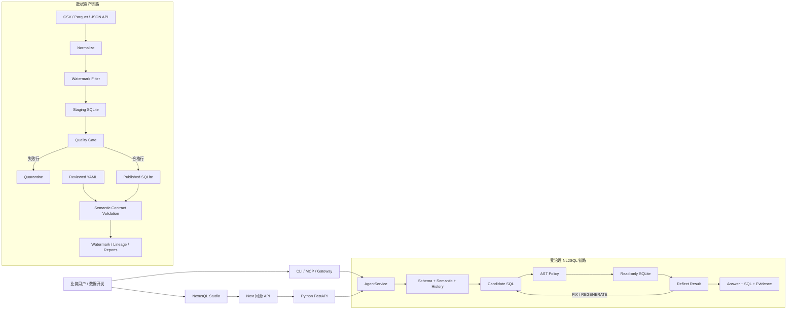
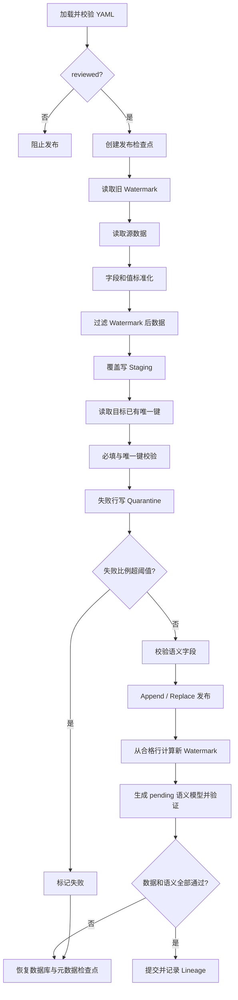
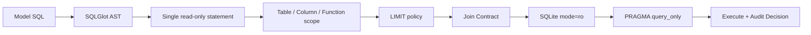

# NexusQL 超详细项目讲解与面试手册

> 适用方向：数据开发、数据工程、数据平台、数据治理、AI 数据应用实习。<br>
> 内容依据：当前仓库代码与样例，而不是脱离实现的产品设想。<br>
> 学习目标：从“会运行项目”提升到“能讲业务价值、能顺代码、能解释取舍、能回答追问”。

---

## 0. 阅读规则：先分清能力层级

本文用三种标签避免面试时夸大：

| 标签 | 含义 | 推荐表达 |
|---|---|---|
| **[已实现]** | 当前代码真实存在，可通过接口、脚本或测试验证 | “当前已经实现……” |
| **[演示实现]** | 流程是真实代码，但为了本地作品演示简化了规模或运行方式 | “为了演示治理闭环，我做了本地可运行版本……” |
| **[生产化设想]** | 当前没有完成，是合理演进方案 | “如果进入生产，我会……” |

能主动说明边界不是示弱，而是工程判断成熟。不要把 Watermark 说成 Flink，不要把幂等说成分布式 Exactly Once，也不要把 SQLite 演示说成亿级生产平台。

---

## 1. 先把项目讲成人话

### 1.1 一句话版本

NexusQL 是一个带数据治理闭环的 AI 数据工程与 NL2SQL 平台：它先把 CSV、Parquet 或分页 JSON API 数据经过标准化、增量过滤、质量校验和语义契约后发布到 SQLite，再把自然语言问题转换为经过语义约束、安全策略和结果反思的只读 SQL。

### 1.2 30 秒版本

NexusQL 包含两条核心链路。数据工程链路使用 YAML 声明数据源、Watermark、质量规则和业务语义，把数据经过 Staging、唯一键与必填字段检查、Quarantine 隔离后发布；分析链路先加载 Schema、指标定义和 Join Path，再生成 SQL，通过 SQLGlot AST 策略和 SQLite 只读连接执行，最后根据查询结果进行反思和有限修复。前端提供数据域、数据源、管道、语义工作台、问答分析和运行历史。

### 1.3 三分钟版本

这个项目解决的是“业务人员想用自然语言查数，但系统不能完全相信大模型”的问题。普通 NL2SQL Demo 往往把 Schema 交给模型，让模型生成 SQL 后直接执行；真实环境中还要回答数据是否合格、指标口径是否明确、Join 是否会让结果翻倍、SQL 是否越权、失败是否可恢复、结果是否可追溯。

因此系统分为数据资产建设和受治理查询两部分。数据资产侧用 YAML 声明数据源、字段映射、Watermark、唯一键、质量阈值和语义信息。管道读取 CSV、Parquet 或分页 API 后统一字段和值，按 Watermark 选出增量，先写 Staging，再执行非空和唯一键检查。坏记录进入 Quarantine；失败比例超过阈值就阻止发布。合格数据写入 SQLite 后，还要结合实际物理表验证实体粒度、主键、值域、关系和 Join Path。数据或语义任一侧失败，发布库、元数据库和 Watermark 都恢复到运行前状态。

分析侧以 `AgentService` 为统一入口，CLI、REST、MCP 与 Gateway 共用同一工作流。问题经过主题选择、日期解析、Schema Linking、技能选择和指标匹配，再生成一个或多个 SQL 候选。SQL 执行前通过 SQLGlot AST 策略，限制语句类型、表、列、函数和 LIMIT；执行使用 SQLite `mode=ro` 与 `PRAGMA query_only` 双重只读保护。执行后 Reflect 节点检查指标、粒度、日期、Join 和结果合理性，必要时在重试预算内局部修复、重新生成或要求人工确认。

当前实现以本地 SQLite 为边界，重点是验证增量、质量、语义、安全和审计如何形成闭环。样例管道已经具有 SQLite 持久化异步状态机和单进程 Worker；生产化时仍要换成外部队列与横向扩展 Worker，并增加 PostgreSQL 或湖仓适配器、复合 Watermark、回看窗口、Upsert、权限和监控。

### 1.4 三个关键词

```text
可信数据 -> 可信语义 -> 可信查询
```

- 可信数据：数据经过标准化、增量、质量和发布门禁。
- 可信语义：指标、粒度、关系和 Join Path 有明确合同。
- 可信查询：模型 SQL 经过确定性策略、只读执行和结果反思。

---

## 2. 项目解决的真实问题

假设业务用户提出：“按设备统计 2025 年 12 月观看时长，并找出表现最好的设备。”直接让模型生成 SQL，可能发生：

1. 不知道“观看时长”使用哪个字段、什么单位、是否除以 3600；
2. 连接观看、用户、商品明细后产生一对多 Fan-out，指标被放大；
3. 漏掉时间范围或使用不存在的字段；
4. 生成写入、删除或越权读取语句；
5. SQL 成功执行，但业务 Grain 和指标口径错误；
6. 无法解释使用了哪个模型、语义版本和安全判断；
7. 被查询的数据可能本身重复、缺失或未完成质量检查。

项目的核心原则是：

> 模型生成的 SQL 应像应用代码一样经过合同、策略、执行边界和运行证据治理，而不是作为可信文本直接执行。

### 为什么适合作为数据开发项目

它覆盖了数据开发常见问题，而不只有 AI：

- 多源批数据接入；
- 字段与值标准化；
- Staging 分层；
- Watermark 增量；
- 必填字段、唯一键、空值率、值域、外键质量；
- Quarantine 异常隔离；
- Lineage、运行证据与契约报告；
- 原子发布与失败恢复；
- 语义模型、指标口径与 Join Path；
- API、前端工作台和运行历史；
- 单元、集成、安全与界面测试。

---

## 3. 当前能力边界

### 3.1 当前真实存在

- **[已实现]** CSV、Parquet、分页 JSON API 数据读取。
- **[已实现]** SQLite 发布库、Staging 库和元数据库分离。
- **[已实现]** 字段映射、字段名和值标准化。
- **[已实现]** Watermark 增量过滤、唯一键去重、必填字段检查和批次质量阈值。
- **[已实现]** Quarantine、Lineage、Watermark、语义目录和合同报告持久化。
- **[已实现]** 数据与语义联合发布门禁、文件检查点和失败恢复。
- **[已实现]** 实体、Grain、Dimension、Metric、Relationship、Join Path。
- **[已实现]** NL2SQL、多个模型提供方、多个候选、反思和有限修复。
- **[已实现]** SQLGlot AST 策略和 SQLite 双重只读执行。
- **[已实现]** CLI、REST、流式事件、MCP、Gateway 等接口。
- **[已实现]** NexusQL Studio 与中英文页面。
- **[演示实现]** 前端管道页面调用本地 `PipelineRuntime`，可演示正常、幂等和质量失败。
- **[已实现]** Web 使用 D1 保存数据域、资产剖析、发布路径和查询运行，使用 R2 保存上传文件。
- **[已实现]** Web 上传单个 CSV/Parquet 后调用 Python 资产构建服务，生成域级 SQLite、语义模型和 SQL 策略，并可在该域内发起真实查询。

### 3.2 当前没有实现

- 没有 Flink 实时任务和 Flink Watermark。
- 没有 Kafka、Debezium 或数据库日志 CDC。
- 没有 MySQL/PostgreSQL Source Adapter。
- 没有 Spark/Flink 分布式计算。
- 没有企业级多租户 RBAC、列级权限和审计留存策略。
- 没有外部生产级调度器、跨进程任务队列和横向扩展 Worker；当前是可恢复的本地编排实现。
- 没有分布式 Exactly Once 保证。
- 当前自定义域发布仍以单文件同步请求为边界；样例管道已实现本地异步 Worker，但尚未实现多表 Join 建模和生产级分布式调度。
- 部分前端指标、关系图和离线结果是产品演示数据，不代表任意文件都能自动推断完整业务语义。

### 3.3 最稳妥的边界表述

> “这是一个以本地 SQLite 为执行边界的可运行参考实现。我重点验证了数据质量、增量幂等、语义合同、安全查询和审计证据如何形成闭环；生产化需要替换存储、调度和权限组件。”

---

## 4. 总体架构



### 4.1 分层与代码

| 层 | 职责 | 代表文件 |
|---|---|---|
| Web 展示层 | 页面、交互、运行状态、演示结果 | `web/app/page.tsx`、`globals.css` |
| Web API 层 | Python API 代理、域/上传/历史接口 | `web/app/api/**` |
| 应用服务层 | 为所有传输入口提供统一用例 | `application/agent_service.py`、`pipeline_runtime.py` |
| 数据资产层 | 读取、转换、增量、质量、发布 | `data_assets/**` |
| 语义领域层 | 实体、指标、关系、Join Path、合同 | `domain/semantic/**` |
| 查询工作流层 | NL2SQL 节点、执行、反思、重试 | `workflow/**` |
| 安全层 | AST 策略与授权范围 | `domain/security/sql_policy.py` |
| 基础设施层 | SQLite、模型、历史、向量库 | `infrastructure/**` |
| 交付接口层 | FastAPI、MCP、Gateway、CLI | `interfaces/**`、`cli.py` |

### 4.2 为什么需要 `AgentService`

`AgentService` 是与传输方式无关的应用门面，它本身不直接实现 SQL 生成，而负责：

1. 校验问题和运行选项；
2. 加载配置与模型提供方；
3. 校验数据库文件；
4. 发现或强制要求语义模型；
5. 管理会话和追问改写；
6. 通过 Entry Router 判断任务类型与复杂度；
7. 构造 `WorkflowRunner`；
8. 返回统一结果或流式事件。

因此 CLI、REST、MCP、Gateway 不会分别复制一套核心逻辑。

---

## 5. 两条链路如何闭环

数据资产链路回答：

> 什么数据有资格进入查询区域，它在业务上表示什么？

输出是已发布数据库、语义模型、Watermark、Lineage、Quarantine 和合同报告。

受治理查询链路回答：

> 如何把业务问题安全地转换为语义合理、可追溯的查询？

输出是 SQL、解释、结果、指标和 Join 证据、安全决策、反思与可选报告。

只有分析没有数据管道，可能在脏数据上生成漂亮答案；只有数据管道，业务用户仍要手写 SQL。项目的价值就是把二者连接起来。

## 6. 数据资产 YAML：数据的处理合同

样例合同位于 `sample_data/data_assets/assets.yml`。CSV 保存记录，YAML 保存“如何处理和理解记录”，包括：

- Source 类型和位置；
- 目标表；
- 原始字段到标准字段的映射；
- Watermark 字段；
- 必填字段与组合唯一键；
- 最大无效比例；
- Entity、Grain、Dimensions、Metric；
- Owner、敏感级别、SLA、刷新频率和质量规则。

### 6.1 是否每个 CSV 都要手写 YAML

底层执行必须获得 YAML 或等价的 `AssetBuildConfig`，因为数据工程任务不能在缺少规则时靠猜测执行。但最终用户不必永远从空白文本写起：

- **[已实现]** 脚本可以搭建资产配置和语义模型草稿；
- **[已实现]** Web 对真实 CSV/Parquet 行进行剖析，返回类型、空值率、基数、候选主键和 Watermark；
- **[已实现]** Owner 审核语义与管道合同后，Web 调用 `DataAssetBuilder` 发布域级 SQLite、语义模型和 SQL 策略；
- **[已实现]** 样例管道拥有 queued/running/终态、失败分类、重试祖先、排队取消和阶段耗时；**[生产化设想]** 将同一编排抽象推广到自定义多资产发布并使用外部 Worker。

面试回答：

> “机器负责生成草案，人负责确认 Grain、指标口径、敏感等级和责任人。`reviewed` 是责任门禁，不只是技术字段。”

### 6.2 为什么用 Pydantic

`AssetBuildConfig` 及子模型配置了 `extra="forbid"`。拼错字段不会被忽略，而是在写数据之前失败。例如把 `watermark_field` 写错，系统不会静默退化成全量任务。这体现 Fail Fast。

### 6.3 配置层直接阻止危险组合

模型禁止同时配置：

```text
watermark_field + publish_mode=replace
```

因为先过滤为增量再 Replace 会用本批少量记录覆盖历史全量。好的配置模型不只是描述字段，也负责阻止逻辑上危险的组合。

---

## 7. 一次数据管道的完整流程



### 7.1 加载配置并审核

`DataAssetBuilder.build_from_file()` 读取 YAML 并通过 Pydantic 解析，相对路径基于 YAML 所在目录解析。`build_all()` 首先要求：

```text
semantic_model.reviewed == true
```

否则不执行发布。直接调用单资产 `build()` 也会被拒绝，防止绕过联合发布门禁。

### 7.2 建立发布检查点

系统备份当前发布数据库和元数据库，形成 `_PublicationCheckpoint`。一次 YAML 可以声明多个资产，而且数据写完后还要验证语义模型；第二个资产或最后的语义检查失败时，前面已经写入的数据也必须恢复，避免半成功状态。

这是文件级补偿方案，不等同于跨服务的分布式事务。

### 7.3 生成 `run_id` 并读取旧 Watermark

每个资产生成 `asset_<uuid>`，再从 `asset_watermarks` 根据 `asset_name` 读取上次成功位置。第一次运行没有旧值。

### 7.4 读取数据源

`read_source()` 当前支持：

| 类型 | 实现 | 注意事项 |
|---|---|---|
| CSV | `csv.DictReader` | `utf-8-sig`，首行字段名 |
| Parquet | `pyarrow.parquet` | 可选依赖，列式文件转记录 |
| API | `urllib.request` | GET、JSON 数组、records_path、页码分页 |

API URL、Header 和参数可以引用 `${ENV_NAME}`，运行时从环境变量替换，避免凭据进入 YAML。

当前没有 TXT 和 MySQL Adapter。TXT 若是明确分隔格式，可以复用 CSV 思路；MySQL/PostgreSQL 需要处理游标分页、一致性快照、凭据、类型映射和断点续传，不能简单 `fetchall()`。

### 7.5 字段和值标准化

`normalize_record()` 先做字段名规范化：

- Unicode 归一化并尽量转 ASCII；
- 非字母数字替换为下划线；
- 转小写；
- 数字开头加 `field_`；
- 应用 `column_aliases`；
- 重名字段追加序号。

值规范化：

- 空字符串和纯空格变 `None`；
- 整数字符串变 `int`；
- 小数字符串变 `float`；
- 字典、列表变 JSON 字符串；
- 普通字符串去首尾空格。

先标准化再检查质量，保证 `""`、`"   "` 和 `NULL` 使用相同空值语义。

### 7.6 Watermark 增量过滤

有 `watermark_field` 时只保留：

```text
row[watermark_field] > watermark_before
```

首次运行全部进入 Staging；相同文件重跑时没有记录大于旧 Watermark，所以 `staged_rows=0`。

比较函数优先尝试 Decimal，失败后用字符串。因此 ISO 8601 或 `YYYY-MM-DD` 可以按字典序比较，任意本地化日期格式则不可靠。

### 7.7 写入 Staging

Staging 表名为 `staging_<asset_name>`，当前采用覆盖式临时表。它的作用是：

- 固化本批增量输入；
- 将读取和转换与正式发布隔离；
- 便于定位错误阶段；
- 给质量校验和后续 Merge 留出边界。

Staging 不是保存全部历史的长期仓库。

### 7.8 唯一键与必填字段

系统先从目标表读取已有唯一键，再扫描本批：

1. 必填字段为 `None`：隔离；
2. 唯一键任何字段为 `None`：隔离；
3. 组合键在目标历史中存在：隔离；
4. 组合键在本批前面出现：隔离；
5. 其余行进入 `accepted`。

组合键用元组表示，例如 `(event_id, watched_at)`，所以可支持单字段或多字段业务键。

当前实现将历史键读入 Set。若历史有 `M` 个键、本批 `N` 行，时间复杂度约 `O(M+N)`，内存也随数据增长，适合中小数据演示。生产改进包括唯一索引、Staging Anti Join、数据库 `MERGE/ON CONFLICT`、分区裁剪或流式状态后端。

### 7.9 Quarantine 与质量阈值

失败行写入 `asset_quarantine`，保存 `run_id`、资产名、失败原因、原始 JSON 和时间。随后计算：

```text
invalid_ratio = quarantined_rows / staged_rows
```

若 `invalid_ratio > max_invalid_ratio`，整批失败。

- Quarantine 回答“坏记录放哪里、如何定位和修复”；
- 质量阈值回答“这一批整体是否允许发布”。

刚好等于阈值不会失败，因为代码使用严格大于 `>`。

### 7.10 语义字段检查与数据发布

发布前确认 Grain、Primary Key、Dimensions 等语义字段在实际数据中存在。随后按 `append` 或 `replace` 写发布表。

### 7.11 Watermark 更新

新 Watermark 只从 `publishable` 合格行计算。假如时间最大的记录不合格，却仍把 Watermark 推到它的位置，那么修复后它会因为不再大于旧 Watermark 而永久丢失。

因此：

> Watermark 表示已经成功处理并允许继续向前的位置，不是曾经看见过的最大值。

### 7.12 语义模型发布

所有资产成功后先生成 `.pending.yml`，再结合实际发布库检查：

- 物理字段；
- 主键/Grain 非空与唯一；
- Schema Drift；
- Null Rate；
- Range；
- 外键孤儿；
- Relationship 与 Join Path。

只有报告通过，pending 文件才替换正式语义文件。

### 7.13 成功提交或失败回滚

任一资产或语义发布失败时：

- 恢复发布库备份；
- 恢复元数据库备份；
- `published_rows` 置零；
- `watermark_after` 恢复为 `watermark_before`；
- 不发布语义模型；
- 记录失败 Lineage 和独立运行证据。

---

## 8. 四类行数指标

| 指标 | 含义 |
|---|---|
| `input_rows` | 从源实际读取的全部行，尚未经过 Watermark |
| `staged_rows` | 标准化后满足增量条件、写入 Staging 的行 |
| `quarantined_rows` | 本批因规则失败而隔离的行 |
| `published_rows` | 真正写入发布表的合格行 |

示例：源文件 1000 行，800 行已处理；剩余 200 行中 3 行缺必填字段、2 行重复：

```text
input_rows       = 1000
staged_rows      = 200
quarantined_rows = 5
published_rows   = 195
```

相同文件再次运行：

```text
input_rows       = 1000
staged_rows      = 0
published_rows   = 0
```

第二次不是没读文件，而是读取后没有新增量。

---

## 9. Watermark、幂等与 Exactly Once

### 9.1 Watermark 是什么

它是资产已经成功处理到的最大业务位置，可以是事件时间、自增 ID、更新时间或生产级复合游标。当前项目按资产保存在 `asset_watermarks`。

### 9.2 与 Flink Watermark 的区别

| 本项目 | Flink |
|---|---|
| 批处理增量游标 | 事件时间进度信号 |
| 决定下次选择哪些记录 | 判断窗口触发和迟到数据 |
| 持久化在元数据库 | 随数据流传播 |
| 类似 ETL 高水位 | 乱序流的事件时间机制 |

概念相关，但项目没有实现 Flink Watermark。

### 9.3 重跑为什么不重复

两层保护：

1. Watermark 过滤已经成功处理的位置；
2. 唯一键阻止目标历史重复和批内重复。

仅 Watermark 无法处理相同时间戳和迟到记录；仅唯一键又会重复读取大量历史。二者分别解决增量选择和业务去重。

### 9.4 为什么不能说 Exactly Once

当前使用单进程锁、本地文件快照、唯一键和 SQLite。准确表述：

> “在单进程、本地 SQLite、稳定业务键和 Watermark 约束下实现可重跑的幂等发布，不宣称分布式 Exactly Once。”

### 9.5 迟到数据

旧 Watermark 为 `2026-01-10`，后来收到 `2026-01-08`，严格 `>` 会漏掉它。生产方案：

1. 每次从 `watermark - lookback_window` 重读；
2. 用业务键 Upsert；
3. 采用 `(event_time, unique_id)` 复合游标；
4. 文件源维护文件清单和校验和；
5. 数据库源使用 CDC 日志位置；
6. 实时场景才使用 Flink Event-time Watermark 与允许迟到。

---

## 10. SQLite 会不会越来越大

会。发布库保存历史和新增记录，持续 Append 时文件会增长。

### 为什么当前仍使用 SQLite

- 零外部依赖，面试官容易运行；
- 单文件便于检查点、回滚和演示；
- 有事务、索引和 SQL；
- 支持只读 URI；
- 项目目标是验证治理闭环，不是承载 PB 数据。

### 当前可做的优化

- 为唯一键、时间和常用过滤列建索引；
- 保留周期与冷数据归档；
- 定期 `VACUUM`；
- 大明细用 Parquet 保存，SQLite 只保留服务层数据；
- 业务数据与元数据分库——项目已这样设计。

SQLite 没有 MySQL/PostgreSQL 那样的声明式表分区。可以按月拆表或拆库，但查询路由更复杂。

### 生产迁移

- 中等并发服务：PostgreSQL；
- 本地大文件分析：DuckDB + Parquet；
- 湖仓批处理：对象存储 + Iceberg/Delta/Hudi + Spark/Trino；
- 实时：Kafka + Flink + 湖仓或 OLAP 引擎。

## 11. 语义层：物理 Schema 之上的业务合同

数据库 Schema 能告诉模型表名、字段名、类型和部分外键，却通常不能告诉模型：

- `watch_seconds` 的单位；
- “观看时长”是否换算成小时；
- GMV 是否排除取消订单；
- 一行事实的真实业务 Grain；
- 指标允许按哪些维度拆分；
- 哪条 Join 不会造成 Fan-out；
- 哪些字段敏感或应该隐藏。

### 11.1 核心对象

#### Entity

业务实体与物理表的映射，例如 `watch_session -> fact_watch_session`。

#### Grain

一行代表什么，例如“一次观看会话”“一个订单商品”“用户每天一行”。Grain 错误会导致聚合和 Join 错误。

#### Dimension

可用于筛选、分组和展示的属性，例如设备、地区、日期。

#### Metric

经过治理的业务指标，包含表达式、所属 Entity、允许 Dimension、时间字段、默认过滤、Owner 和敏感级别。

#### Relationship

实体之间的关系及其基数。

#### Join Path

跨 Entity 分析时允许使用的明确关系序列，避免模型自由猜连接路径。

### 11.2 Join Fan-out 示例

`fact_watch_session` 一行是一场观看，`fact_merch_order_item` 一行是一个订单商品。若按用户直接连接，一个用户有 10 场观看和 3 个商品项，就产生 30 行，观看时长被放大 3 倍。

项目把 Metric 绑定基础 Entity 和允许维度，跨实体时解析声明的 Join Path；执行节点还会检查 SQL 是否遗漏必要表，以及未声明 Join 是否会扩大指标基础 Grain。

### 11.3 为什么必须人工 Reviewed

机器可以推断字段类型、空值率、候选主键和候选外键，但很难承担指标口径、真实 Grain、敏感等级、允许维度和 Owner 的业务责任。因此自动化生成草稿，人确认后才允许 `reviewed: true`。

### 11.4 两层质量检查不要混淆

第一层在行级发布前：必填字段、唯一键和无效比例，决定哪些记录进入目标表。

第二层在语义发布前：Schema Drift、主键/Grain、Null Rate、Range、Foreign Key 和 Join Path，结合完整发布表验证业务合同。

第一层回答“本批记录能不能进入”，第二层回答“发布后的表是否仍符合被承诺的业务结构和质量”。

---

## 12. NL2SQL 工作流逐节点讲解

### 12.1 Web 请求入口

浏览器向同源地址请求：

```text
POST /api/queryforge/ask
```

Next 代理只允许固定路径，再转发到 `QUERYFORGE_API_URL`，默认 `http://127.0.0.1:8000`。这样可以减少 CORS、隐藏后端拓扑、集中限制路径和超时，并为认证、限流留出位置。

### 12.2 `AgentService.ask()`

它依次完成：

1. 拒绝空问题；
2. 校验 AgentOptions；
3. 加载配置和模型提供方；
4. 校验 SQLite 文件存在；
5. 自动发现相邻语义模型；
6. 强制语义模式下拒绝 Schema-only 查询；
7. 加载会话并改写追问；
8. Entry Router 判断任务类型和复杂度；
9. 构造 `WorkflowRunner`；
10. 执行并返回结果。

### 12.3 Subject Selection

将问题限定到某个主题域，减少全库搜索空间，类似数仓主题域路由。

### 12.4 Date Parser

把“上个月”“去年第四季度”等时间表达转成明确边界。时间过滤是 NL2SQL 高频错误，因此独立处理。

### 12.5 Schema Linking

从全库挑出相关表、字段、外键和可能的字段值，避免把所有 Schema 无限制放入 Prompt，也降低错误选表概率。

### 12.6 Skill Selection 与 Metric Search

Skill Selection 选择与当前问题相关的本地提示知识，例如 SQL 最佳实践、数据质量和安全治理。

Metric Search 查找结构化指标。匹配后，指标表达式、允许维度、默认过滤和时间字段成为权威约束，而不是由模型临时发明。

### 12.7 Bounded Tool Loop

复杂问题可以有限调用只读工具描述表、搜索参考 SQL 或查看字段值。轮数、总时间和预览行数都有预算，避免 Agent 无限循环和不可控成本。

### 12.8 SQL 候选生成与选择

简单模式可生成一个候选；复杂模式至少两个。多个候选不是越多越好，会增加模型调用和执行开销。系统使用确定性权重考虑安全、执行、语义适配和结果特征。

### 12.9 Execute

执行前先验证 Join Contract，再通过 `DatabaseTool` 执行 SQL Policy，最后进入只读 SQLite。

### 12.10 Reflect

数据库成功只说明语法和物理字段可执行，不代表业务正确。Reflect 会检查：

- Metric 表达式；
- Grain；
- Join 与 Fan-out；
- Filter 和 Date；
- Ordering、Limit、Columns；
- 空结果是否合理；
- 是否有歧义需要人工确认。

只允许四种策略：

- `SUCCESS`：接受；
- `FIX_SQL`：局部修复；
- `REGENERATE`：整体重新生成；
- `NEED_USER_REVIEW`：业务含义不足，交给人。

### 12.11 有限重试

超过 `max_retries` 后工作流失败并携带 Attempt History，不会无限自我修复。重试预算是可靠性和成本控制的一部分。

---

## 13. SQL 安全为何使用 AST



### 13.1 正则为什么不够

正则难以可靠处理注释、大小写、CTE、子查询、函数嵌套、引号标识符、多语句和复杂结构中的写操作。SQLGlot 先构建语法树，策略才能基于真实节点和引用对象判断。

### 13.2 多层防御

策略可限制：

- 单条语句；
- 只读查询类型；
- 表白名单；
- 列白名单；
- 函数范围；
- 必须存在的 LIMIT 和最大行数；
- 审计记录。

执行层再使用：

```text
SQLite URI mode=ro
PRAGMA query_only = ON
```

### 13.3 为什么使用短连接

每个 SQLite 操作都打开、配置并关闭连接，明确释放文件资源。尤其在 Windows 上，长连接会占用数据库文件，导致发布检查点恢复、文件替换或测试清理失败。

### 13.4 安全边界

只读不等于无风险：超大 Join 可能消耗资源，敏感列仍需权限和脱敏，API 还需认证、限流和租户隔离。因此只应声称在配置后的 SQLite 查询边界内提供分层防护。

---

## 14. 前端工作台逐页讲解

### 14.1 Data Domains

数据域是治理边界，每个域有 Owner、状态、数据源和运行历史。`Anime Streaming` 是完整样例；新域默认为 Draft，不会继承样例实体和指标。

### 14.2 Overview

展示当前域的准备状态、语义健康、指标和最近活动。样例域使用内置展示数据，新域显示自身 readiness。

### 14.3 Data Sources

Web 的可执行上传支持单个 CSV/Parquet，限制 25 MB；提交前必须选择 Domain，并发送已审核的语义合同与主键、Watermark、必填字段、最大无效率等管道合同。

要准确区分：

- Profile API 读取真实数据，生成物理统计和保守草稿；
- Web 上传路由负责 R2 文件保存并调用 Python 发布服务；
- Python `DataAssetBuilder` 负责标准化、Staging、质量、Quarantine、Watermark、SQLite 和语义发布；
- D1 保存返回的数据库、语义模型、SQL 策略、run_id、行数、Profile 和 Watermark。

发布成功的新域会使用自己的可执行路径进入 NL2SQL，查询失败时不会替换成 Anime 样例结果。自定义域当前仍是同步单资产发布；异步状态机目前服务内置可执行管道，不应说成分布式调度平台。

### 14.4 Data Pipelines

页面使用：

```text
GET  /engineering/pipeline/status
POST /engineering/pipeline/run?scenario=standard
POST /engineering/pipeline/run?scenario=quality_failure
```

`PipelineRuntime` 汇总 Source、Staging、Quality、Publish、Watermark、Lineage、Quarantine 和最近运行；`PipelineRunOrchestrator` 把任务状态持久化到 SQLite，单进程 Worker 串行执行，记录 attempt、retry_of、失败类型及排队/执行/阶段耗时。进程内锁仍是最终执行保护，不是跨实例锁。

### 14.5 Semantic Studio

展示 Entity Graph、Metric Catalog 和 Join Paths。示例域内容对应内置语义样例；新域需要先完成语义合同。

### 14.6 Ask & Analyze

展示问题输入、运行阶段、答案、SQL、结果表和 Trust Trace。后端在线时请求真实 API；离线时使用 Demo Evidence 保证展示稳定。面试演示必须主动说明是 LIVE 还是 DEMO。

### 14.7 Run History

按数据域保存问题、状态、模型、行数和耗时。它是轻量运行历史，不是完整企业审计平台。

### 14.8 语言切换

语言状态由 React Context 提供，并写入 `localStorage` 的 `nexusql-language`。这是可用性特性，不应作为简历核心技术亮点。

---

## 15. 四类存储不要混淆

### 15.1 Published SQLite

保存已通过门禁、可供查询的业务表。

### 15.2 Staging SQLite

保存当前批经过标准化和 Watermark 过滤的中间记录，不是历史全量库。

### 15.3 Metadata SQLite

保存 Watermark、Lineage、Quarantine、Semantic Catalog、Contract Report 和 Pipeline Evidence。

### 15.4 Web D1 与 R2

D1 保存 `studio_domains`、`studio_sources`、`studio_runs`；R2 保存上传文件。它们服务于托管 Studio，不是 Python 数据处理引擎。

---

## 16. 元数据表逐张解释

### `asset_watermarks`

每个资产的当前成功位置，并保留推进它的 `run_id` 和时间。

### `asset_lineage`

记录来源、目标、Input/Staged/Published/Quarantined 行数、前后 Watermark、状态与错误。它是运行级资产血缘，不是完整字段级血缘。

### `asset_quarantine`

保存逐行失败原因和原始 JSON，用于定位、修复和补数。生产环境需要权限、脱敏、保留期和删除策略。

### `semantic_catalog`

保存资产、目标表、物理字段和语义定义的对应关系。

### `semantic_contract_reports`

保存模型检查汇总与完整报告，证明语义发布前实际执行过哪些规则。

### `pipeline_run_evidence`

Studio 演示层补充的运行快照，保存场景、结果和 Quarantine Evidence。审计证据与可回滚元数据的生命周期不同，因此单独保存。

---

## 17. 四条主要调用链

### 17.1 问答

```text
Browser
-> POST /api/queryforge/ask
-> Next proxy allowlist
-> FastAPI /ask
-> AgentService.ask
-> WorkflowRunner
-> Policy + Read-only SQLite
-> Result JSON
-> Studio Result + Trust Trace
```

### 17.2 管道

```text
Browser
-> POST /api/queryforge/engineering/pipeline/run
-> Next proxy
-> FastAPI pipeline_run
-> PipelineRuntime.run
-> DataAssetBuilder.build_from_file
-> Metadata + Result
-> PipelineRuntime.status
-> Pipeline View
```

### 17.3 数据域创建

```text
Browser -> POST /api/studio/domains
-> validate name
-> generate domain_<uuid> and slug
-> insert D1 as Draft
-> return domain
```

### 17.4 上传

```text
FormData: domain_id + reviewed + semantic_contract + files
-> extension/size/contract validation
-> R2 domains/<domain>/sources/<source>/...
-> D1 studio_sources metadata
-> return ready source metadata
```

## 18. 三种必须会演示的运行结果

### 18.1 第一次正常运行

预期：

- `input_rows > 0`；
- `staged_rows > 0`；
- `published_rows > 0`；
- Watermark 前进；
- 合同通过；
- Lineage 成功。

讲解重点：数据只有在物理质量和业务语义同时通过后才可查询。

### 18.2 相同输入再次运行

预期：

- 文件仍然被读取，所以 `input_rows > 0`；
- 没有新位置，所以 `staged_rows=0`；
- 没有新增发布，所以 `published_rows=0`；
- Watermark 不变；
- `idempotent=true`。

幂等不是“不运行”，而是重复执行不产生额外业务结果。

### 18.3 受控质量失败

`PipelineRuntime` 复制样例 CSV 到场景目录，追加一条时间更新但缺少 `anime_title` 的记录，再用相同合同执行。

预期：

- 新坏行进入 Staging；
- Required Column 检查失败；
- Quarantine Evidence 可见；
- 失败比例 `1/1` 超过 0.05；
- 发布回滚，Watermark 不推进；
- 页面展示错误和坏记录。

失败演示的价值不是“故意报错”，而是证明错误可解释、坏行可定位、旧版本可保留、增量位置不丢失。

---

## 19. 测试策略：先讲风险，再讲数量

### 数据资产测试

- 三类 Source；
- 标准化；
- Watermark；
- 历史与批内唯一键；
- Quarantine 和质量阈值；
- Reviewed Gate；
- 语义合同；
- 多资产原子恢复。

### SQL 安全测试

- 单语句和只读；
- 表、列、函数范围；
- LIMIT；
- CTE 与子查询；
- 审计判断；
- SQLite 文件生命周期。

### 工作流测试

- 日期解析和 Schema Linking；
- 指标到 SQL；
- 多候选；
- Tool Loop 预算；
- Reflect、Fix、Regenerate；
- 会话追问；
- 流式事件。

### Web 测试

- NexusQL 品牌和主要产品区域；
- 数据域与语义审核门禁；
- 构建产物和品牌资源；
- 上传 API 强制 Domain 与完整语义合同。

推荐表达：

> “我把最危险的状态转换作为测试重点：只读 SQL、失败不推进 Watermark、重复运行不重复发布、语义合同失败整批恢复，以及不同接口复用同一应用服务。”

---

## 20. 技术选型与取舍

### Python + Pydantic

适合数据与 AI 生态；Pydantic 把外部 YAML、API 参数和模型输出转成可校验合同。

### SQLGlot

用于结构化 SQL AST 策略和方言处理，比字符串匹配可靠。

### SQLite

降低运行门槛，适合只读安全、文件检查点和本地审计；代价是并发、分区和大规模能力有限。

### YAML

人可读、可版本控制、便于 Review；复杂合同会冗长，因此需要脚手架和 UI 辅助。

### React/Next Studio

把分散 CLI 能力组织成数据域工作台。当前 `page.tsx` 体积较大，是明确技术债。

### D1/R2

保存托管 Studio 的结构化状态和文件对象，不负责 Python 数据转换或 NL2SQL 执行。

---

## 21. 当前最值得优化的内容

### 已完成：新数据域的真实执行闭环

当前新域上传会真实剖析文件、执行 `DataAssetBuilder`，并把 Published DB、
Semantic Model 和 SQL Policy 路径保存到 Domain 数据源记录。`/ask` 使用这些
域级资源，失败时不会回退到内置样例。

仍需补充：自定义上传异步化、服务端 Domain 资源注册表、身份权限、数据版本
与语义版本关联，以及多资产 Join Path 审核。

### 已完成基础版：异步 Run 状态机

```text
API -> create run -> Queue -> Worker -> Stage Events -> Status API
```

当前已支持 Queued、Running、Succeeded、Failed、Cancelled，SQLite 持久化、
失败分类、人工重试、排队取消、重启恢复和阶段耗时。生产化仍需外部 Queue、
Worker 心跳、租约超时、指数退避和跨实例并发控制。

### 已完成基础版：迟到数据与 Upsert

当前支持 ISO 时间 Watermark 的有界 Lookback Window、业务键唯一索引和
SQLite Upsert，并记录 late/insert/update 行数。下一步增加复合 Watermark、
Source 谓词下推、文件清单和 PostgreSQL/湖仓 MERGE。

### P1：PostgreSQL / DuckDB Adapter

- PostgreSQL 更适合并发服务和数据开发岗位；
- DuckDB 更适合 Parquet 与本地分析。

### P1：拆分前端

建议：

```text
components/layout
components/domains
components/pipelines
components/semantic
components/analysis
hooks/useDomains
hooks/usePipeline
hooks/useQueryRun
lib/i18n
lib/api
```

### P2：可观测性与权限

补充阶段耗时、吞吐、错误码、Trace ID、P95、告警、Domain RBAC、列级权限、脱敏和密钥管理。

---

## 22. 数据量扩大 1000 倍的系统设计

### 控制面

- PostgreSQL 保存 Source、Contract、Run、Version 与 Audit；
- API 只创建任务和查询状态；
- 调度器处理依赖、重试和 SLA；
- 消息队列分发任务；
- 无状态 Worker 执行；
- 对象存储保存 Raw、Staging 和产物；
- OpenTelemetry + Prometheus/Grafana 观测。

### 数据面

- 数据库源：分页 JDBC/SQLAlchemy；
- 批量文件：分区 Parquet；
- 大规模转换：Spark/Trino；
- 实时：Kafka + Flink；
- 湖仓：Iceberg/Delta/Hudi；
- 查询：Trino/ClickHouse/Doris 等。

### 可靠性协议

- Run 状态机；
- 租约或分布式锁；
- 幂等键；
- 分区 Staging；
- 质量通过后切换版本指针；
- 乐观并发控制；
- 失败补偿；
- Watermark 与数据版本原子提交。

---

## 23. 高频面试问题与参考回答

### Q1：核心价值是什么？

把数据进入查询区之前的质量治理，与模型生成 SQL 之后的语义和安全治理连接起来。LLM 被限制在数据域、语义合同、SQL 策略和只读执行边界内。

### Q2：与普通 NL2SQL 有什么区别？

普通 Demo 常止于“问题 -> SQL -> 结果”。本项目增加上游数据质量与联合发布、结构化 Metric 与 Join Path、AST 安全策略、只读执行、有限修复和审计证据。

### Q3：YAML 谁来写？

底层需要显式合同。可手写或由脚本/UI 生成草稿，但 Grain、Metric、Sensitivity 与 Owner 必须由人审核。

### Q4：为什么需要 Staging？

隔离读取转换和正式服务表，让质量检查、问题定位、重跑和发布门禁有明确边界，避免脏数据直接进入查询区。

### Q5：唯一键如何检查？

把目标表已有组合键放入 Set，扫描本批时把新键加入同一个 Set，从而发现历史重复和批内重复。生产改为唯一索引、Anti Join 或 Merge，避免加载亿级键。

### Q6：Quarantine 和质量阈值分别做什么？

Quarantine 保存逐条坏记录及原因，负责追溯与修复；阈值判断整批是否可发布，负责批次门禁。

### Q7：为什么 Watermark 从合格数据计算？

因为它表示成功提交位置。若使用失败记录最大值，修复后该记录会被过滤，造成永久丢数。

### Q8：相同 CSV 为什么不重复？

Watermark 过滤旧位置，唯一键阻止历史和批内重复。重跑可出现 `input>0`、`staged=0`、`published=0`。

### Q9：这是 Exactly Once 吗？

不是分布式 Exactly Once，而是单进程 SQLite 边界内的可重跑幂等发布语义。

### Q10：失败后为什么不推进 Watermark？

发布数据和元数据都有检查点，任何资产或语义失败都会恢复元数据库，Watermark 回到运行前。

### Q11：为什么用 SQLite？

为了零依赖、可复现、只读和文件级恢复。生产会按并发与数据量迁移 PostgreSQL、DuckDB 或湖仓。

### Q12：SQLite 越来越大怎么办？

先索引、归档、保留期和 Parquet 冷存；继续增长时替换引擎。SQLite 没有原生声明式分区，不声称当前已分区。

### Q13：为什么没有 MySQL？

当前只实现三种 Adapter。MySQL 需要分页/游标、一致性快照、凭据、类型映射和断点续传，不能加个连接字符串就算完整支持。

### Q14：语义层为何重要？

Schema 描述结构，语义层描述业务 Grain、指标公式、允许维度、时间字段、关系和敏感级别。SQL 语法正确仍可能语义错误。

### Q15：如何防止 Join 后指标翻倍？

Metric 绑定基础 Entity 和允许 Dimension，跨实体必须解析声明的 Join Path；执行前检查路径和基数，阻止危险 Fan-out。

### Q16：为什么执行后还要 Reflect？

成功执行不证明指标、日期、粒度和 Join 正确。Reflect 使用问题、SQL、Schema、Metric、Join Path 和结果样例二次判断。

### Q17：如何防危险 SQL？

SQLGlot AST 限制类型、表列函数和 LIMIT；再校验 Join；最后用 SQLite `mode=ro` 与 `query_only` 执行并记录策略证据。

### Q18：为什么前端不直连 8000？

同源代理减少 CORS、隐藏后端拓扑、限制路径、统一超时，并为认证与限流提供位置。

### Q19：项目最难的地方是什么？

一是保证数据、语义和 Watermark 的提交顺序，失败不留下半成功；二是区分 SQL 可执行与业务正确，用 Metric、Join Path、Policy 和 Reflect 形成多层治理。

### Q20：当前最大不足是什么？

新域的单文件上传、Python 资产构建与真实查询已经串联，样例管道完成本地异步状态机，资产管道也支持有界 Lookback 与 Upsert；当前最大不足是自定义上传仍同步、单资产建模、单进程 Worker 和 SQLite 边界。优先补数据库 Adapter、外部队列、多表关系审核与复合游标。

### Q21：两个任务同时运行怎么办？

当前 `PipelineRuntime` 用进程内非阻塞锁，第二个请求失败。生产应使用队列、数据库租约或分布式锁，并配合幂等键。

### Q22：离线 Demo 会不会造假？

离线证据用于稳定展示，页面区分 LIVE 与 DEMO；真实能力可通过 Python API、元数据库和测试验证。演示时必须主动说明模式。

### Q23：字符串 Watermark 安全吗？

仅对规范 ISO 日期或字典序可排序值可靠。当前先尝试 Decimal，否则字符串。生产应声明类型并解析为 UTC 时间或原生数据库类型。

### Q24：质量阈值刚好 5% 是否失败？

不会，代码是 `invalid_ratio > threshold`，超过才失败。

### Q25：为何发布数据后还要合同校验？

配置校验只能检查声明格式；结合实际表才能验证字段、主键、值域、外键和 Schema Drift。

### Q26：语义失败后数据怎么办？

恢复发布库和元数据库，发布行数置零、Watermark 回退，pending 语义文件不会成为正式文件。

### Q27：短连接的价值？

明确释放资源，尤其避免 Windows 长连接占用 SQLite 文件导致替换、回滚或清理失败。

### Q28：SQL 候选越多越好吗？

不是。候选增加成本和延迟。复杂模式至少两个，并受预算和选择器控制；生产应基于离线评测确定数量。

### Q29：项目是否用了多 Agent？

代码包含 Agent Team 编排，但面试主线更适合放在数据治理与受控 NL2SQL。除非能解释角色、共享状态和 Gate，否则不要把“多 Agent”当第一卖点。

### Q30：重做一次先改什么？

当前已完成 Domain 资源解析和本地异步 Run 状态机；下一步拆分前端组件，实现 PostgreSQL Adapter、外部 Worker、复合 Watermark 与 Upsert，最后补 E2E 和故障注入。

---

## 24. 故障排查题

### `input_rows=1000`，`staged_rows=0`

检查是否重复运行、所有记录是否不大于 Watermark、日期格式能否正确排序、Watermark 是否异常推进。

### `staged_rows>0`，`published_rows=0`

检查是否全部违反必填/唯一键、是否超质量阈值、语义字段是否缺失、合同是否失败，或者成功写入后又被整批恢复。

### 目标表出现重复

检查唯一键是否是真实业务键、标准化是否改变键、历史是否已有脏数据、同时间戳是否多记录，以及多个进程是否绕过单进程锁。

### 查询结果翻倍

检查事实 Grain、Join 基数、多值中间表、聚合发生在 Join 前还是后、是否使用声明 Join Path，是否需要先聚合子表。

### 页面显示 DEMO

检查 Python API 8000、`/health`、`QUERYFORGE_API_URL`、Next 路径白名单和 2.5 秒健康检查超时。

### API 503 但任务可能已完成

样例管道现在先返回 Run ID，由后台执行并由客户端按 ID 查询终态；仍需为创建请求增加幂等键，并把这一模式推广到自定义资产发布和外部 Worker。

## 25. 白板绘图与讲解顺序

不要一开始画几十个模块。按下面顺序：

1. 左边画 CSV/Parquet/API；
2. 中间画 Normalize、Watermark、Staging、Quality；
3. Quality 分叉到 Quarantine 和 Published DB；
4. 上方画 Reviewed YAML；
5. YAML 与 Published DB 汇合到 Semantic Validation；
6. 右边画 User Question；
7. 画 Schema/Semantic、SQL Generation、Policy、Read-only Execute、Reflect；
8. 最后补 Studio/API 入口和 Metadata/Evidence 底座。

第一层只画：

```text
Source -> Governed Pipeline -> Published Data -> Governed NL2SQL -> Result
```

面试官追问时再逐层展开。

---

## 26. 简历写法

### 26.1 三行稳妥版

**NexusQL——可治理的 AI 数据工程与 NL2SQL 平台**<br>
基于 Python、SQLite、Pydantic、SQLGlot 与 React，构建 CSV/Parquet/API 数据接入、Staging、Watermark 增量处理、质量校验、Quarantine 和语义合同发布链路；实现基于结构化指标、Join Path、AST 安全策略和只读执行的 NL2SQL 工作流，并通过运行证据与有限重试提高结果可审计性。

### 26.2 四点详细版

- 设计声明式数据资产管道，支持 CSV、Parquet 与分页 JSON API，通过字段标准化、Watermark、组合唯一键、质量阈值和 Quarantine 实现可重跑的增量发布。
- 建立数据与语义联合发布门禁，使用检查点保证资产或语义合同失败时恢复发布库和 Watermark，并记录 Lineage、合同报告和运行证据。
- 构建受治理 NL2SQL 工作流，引入结构化 Metric、Join Path、SQLGlot AST 策略、SQLite 双重只读执行、结果反思和有界修复。
- 开发 NexusQL Studio，覆盖数据域、数据源、管道可观测、语义工作台、问答分析和运行历史，并通过 FastAPI 与同源代理连接 Python 服务。

### 26.3 不建议写

- “基于 Flink 实现 Watermark”；
- “支持亿级实时数据”；
- “保证 Exactly Once”；
- “企业级多租户”；
- “支持所有数据库”；
- 没有真实评测却写“SQL 准确率 99%”。

---

## 27. STAR 项目故事

### Situation

自然语言查数降低了 SQL 使用门槛，但模型生成的查询缺乏数据质量、业务语义、安全和审计保证，普通 Demo 也难以解释数据从哪里来、为什么可信。

### Task

构建一个本地可运行的参考平台，把数据资产发布和 NL2SQL 放入同一治理边界，保证失败可定位、可恢复，查询可审计。

### Action

将系统拆成两条链路：数据侧采用 YAML、标准化、Watermark、Staging、Quality、Quarantine、Checkpoint 和 Semantic Validation；查询侧采用统一应用服务、Metric、Join Path、SQL AST Policy、Read-only Execution、Reflect 和 Retry Budget。再用 Studio 把 Domain、Pipeline、Semantic 与 Query Evidence 组织为可演示界面，并覆盖关键边界测试。

### Result

形成可演示正常发布、重复运行幂等、质量失败恢复和受治理查询的完整闭环。每次运行产出不只是 SQL，还包含数据位置、语义合同、策略决策、Run ID、查询结果与失败证据。

没有测量时不要编造“性能提升 80%”等数字。

---

## 28. 一天学习路线

### 第 1 小时：全貌

- 练一句话和 30 秒介绍；
- 画两条链路；
- 背熟能力边界。

### 第 2～3 小时：数据管道

- 阅读 `assets.yml`；
- 阅读 `models.py`、`transforms.py`；
- 顺 `_build_asset()` 手画流程；
- 解释四类行数、Quarantine、Watermark。

### 第 4 小时：联合发布和语义

- 阅读 `build_all()`；
- 解释 Checkpoint 与 Reviewed Gate；
- 解释 Grain、Metric、Relationship、Join Path。

### 第 5～6 小时：NL2SQL 与安全

- 顺 `AgentService -> WorkflowRunner -> ReflectiveWorkflow`；
- 解释 Schema Linking、Metric Search、候选和 Reflect；
- 找到 AST Policy 与 SQLite 只读连接。

### 第 7 小时：前端与 API

- 点完各页面；
- 看 `/api/queryforge` 代理；
- 区分 D1/R2 与 Python SQLite；
- 区分 LIVE 和 DEMO。

### 第 8 小时：演示与模拟

- 正常运行一次；
- 重复运行一次；
- 质量失败一次；
- 录一遍三分钟介绍；
- 随机回答本手册 30 个问题。

---

## 29. 面试前必须亲手做

1. 在 `assets.yml` 指出 Source、Watermark、Quality 和 Semantic。
2. 修改 `max_invalid_ratio`，预测等于和超过阈值的结果。
3. 找到唯一键代码，解释 `existing_keys` 和 `seen`。
4. 找到 Watermark 更新代码，确认输入是 `publishable`。
5. 找到 Checkpoint 创建与恢复。
6. 找到 SQLite `mode=ro` 和 `query_only`。
7. 找到 Next API Allowlist。
8. 完成标准、幂等、质量失败三次演示。
9. 查看 Metadata SQLite 中的 Watermark、Lineage 和 Quarantine。
10. 在问答页确认当前是 LIVE 还是 DEMO。

---

## 30. 最终自测清单

- [ ] 能用一句话说项目，不先堆框架名。
- [ ] 能画数据资产与 NL2SQL 两条链路。
- [ ] 能区分 input、staged、quarantined、published。
- [ ] 能解释 Watermark 为什么从合格数据计算。
- [ ] 能解释 Watermark 与唯一键的职责差异。
- [ ] 不把项目 Watermark 说成 Flink Watermark。
- [ ] 能解释 Staging、Quarantine 与质量阈值。
- [ ] 能解释 YAML 为什么需要人工 Reviewed。
- [ ] 能解释数据和语义失败如何恢复。
- [ ] 能解释 Grain、Metric、Relationship、Join Path。
- [ ] 能举 Join Fan-out 的例子。
- [ ] 能解释 SQL 成功不等于业务正确。
- [ ] 能解释 AST 与 SQLite 只读双重保护。
- [ ] 能说明 SQLite 的优势、边界与迁移路径。
- [ ] 能区分 Python Metadata SQLite 与 Web D1/R2。
- [ ] 能说明新域尚未完全接入真实查询。
- [ ] 能主动区分 LIVE 与 DEMO。
- [ ] 不声称 Exactly Once、Flink、Kafka 和亿级生产能力。
- [ ] 能提出有顺序的三项生产改进。
- [ ] 能完成三分钟介绍和八分钟演示。

---

## 31. 代码阅读地图

| 想理解什么 | 文件 |
|---|---|
| 命令入口 | `queryforge/cli.py` |
| 统一应用服务 | `queryforge/application/agent_service.py` |
| 数据资产主流程 | `queryforge/data_assets/pipeline.py` |
| YAML 强类型模型 | `queryforge/data_assets/models.py` |
| CSV/Parquet/API | `queryforge/data_assets/sources.py` |
| 标准化、质量、Watermark | `queryforge/data_assets/transforms.py` |
| 管道演示 Runtime | `queryforge/application/pipeline_runtime.py` |
| 语义模型 | `queryforge/domain/semantic/schemas.py` |
| 语义合同校验 | `queryforge/domain/semantic/contract_validator.py` |
| 工作流装配 | `queryforge/workflow/workflow_runner.py` |
| 工作流状态机 | `queryforge/workflow/workflow.py` |
| SQL 执行与 Join Gate | `queryforge/workflow/node/execute_sql_node.py` |
| 结果反思 | `queryforge/workflow/node/reflect_node.py` |
| SQL AST 策略 | `queryforge/domain/security/sql_policy.py` |
| SQLite 只读执行 | `queryforge/infrastructure/db/sqlite_connector.py` |
| FastAPI | `queryforge/interfaces/api/app.py` |
| Web 主页面 | `web/app/page.tsx` |
| Python API 代理 | `web/app/api/queryforge/[...path]/route.ts` |
| Domain API | `web/app/api/studio/domains/route.ts` |
| Upload Gate | `web/app/api/studio/upload/route.ts` |
| Studio Schema | `web/db/runtime.ts`、`web/db/schema.ts` |
| 样例资产合同 | `sample_data/data_assets/assets.yml` |
| 样例语义模型 | `sample_data/anime_streaming/semantic_model.yml` |
| 样例 SQL 策略 | `sample_data/anime_streaming/sql_policy.yml` |

---

## 32. 术语速查

| 术语 | 一句话解释 |
|---|---|
| Staging | 正式发布前的隔离暂存层 |
| Watermark | 最后成功处理的增量位置 |
| Idempotent | 重复执行不产生额外业务结果 |
| Quarantine | 存放问题记录及失败原因的隔离区 |
| Grain | 一行事实代表的业务含义 |
| Semantic Layer | 物理字段之上的业务实体、指标和关系 |
| Join Path | 被允许且可解释的实体连接路径 |
| Lineage | 数据从来源到目标的运行级依赖证据 |
| Contract | 可版本化、可校验的数据或语义约束 |
| Atomic Publish | 对外只暴露完整旧版本或完整新版本 |
| Rollback | 失败后恢复上一稳定状态 |
| AST | SQL 的结构化语法树 |
| Upsert | 存在则更新，不存在则插入 |
| CDC | 捕获源数据库变更事件或日志位置 |
| Retry Budget | 允许的有限重试次数、时间或成本 |

---

## 33. 最终理解

NexusQL 不是“输入问题就生成 SQL 的网页”。更准确地说：

> NexusQL 用数据域确定治理边界，用数据资产管道保证进入查询区的数据经过增量、质量和语义发布，用结构化语义限制模型对指标和 Join 的理解，用 AST 策略和只读数据库限制执行权限，再用反思、历史和证据解释每次查询为什么被允许以及结果从哪里来。

最后只记一条链路：

```text
源数据
-> 标准化
-> 增量过滤
-> Staging
-> 质量检查
-> 数据与语义联合发布
-> 自然语言问题
-> 语义约束 SQL
-> 安全只读执行
-> 结果反思与审计
```

这就是整个项目在数据开发实习面试中最有价值、也最应该讲清楚的内容。
